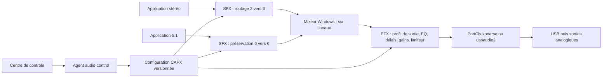

# Backlog de chantier — Xonar SE Open Driver

## 1. Contrats d’interface figés

Version du backlog : **1.0 — 28 octobre 2026**. Livrable de conception uniquement : aucun chantier ci-dessous n’est exécuté par la création de ce fichier. Les propriétaires `claude`, `deepseek`, `codex` sont des affectations proposées pour les futures exécutions.

**Portée du gel :** C1 à C8 sont les spécifications de référence des branches de chantier, pas une affirmation d’implémentation. C1 décrit séparément l’API existante et ses ajouts prévus. Les dépendances de validation E0-03/E0-04 interdisent de transformer une hypothèse Windows en fonctionnalité annoncée. Chaque contrat est **versionné, figé ; ne pas modifier sans ADR**, migration et tests de compatibilité. Une version majeure inconnue est refusée, jamais interprétée approximativement. E0-02 matérialise ces contrats ; les consommateurs ne les réécrivent pas.

### 1.1. État établi et limites de preuve

La lecture du dépôt prime sur le résumé du prompt. `[C-code]` désigne un fait visible dans les sources ; `[C-journal]` un résultat rapporté dans le dépôt, non rejoué pendant cette rédaction ; `[T]` une vérification à faire ; `[D]` une décision proposée dans ce backlog.

| Domaine | Constat et conséquence de conception | Preuve lue |
| --- | --- | --- |
| Pilote installé | `[C-journal]` `xonarse.sys` 0.3.3.0, paquet alors nommé `oem82.inf`, validé par Benoist sur le PC principal en mode test ; son partagé corrigé, routage et niveaux jugés corrects. Cela ne prouve ni une endurance de 24 h ni la conformité HLK. | [driver-vm-setup.md, journal §7](driver-vm-setup.md) |
| Position WaveRT | `[C-code]` `CopyFromRingLocked` avance le prélèvement ; `AdvancePlayedLocked` avance la position jouée et déclenche les notifications. Ce comportement devient une non-régression obligatoire. | `src/driver/xonarse/wave/iso_engine.cpp` |
| Formats | `[C-code]` rendu PCM 16/24 bits compacts ; 44 100/48 000/96 000/192 000 Hz candidats ; masques 2.0, 4.0, 5.1. `[C-journal]` horloges 21/22/23 interrogées, tests exclusifs multirates rapportés. Les horloges de capture 24/25 restent à confirmer. | `hw_xonarse.h`, `wave/wave_formats.cpp`, journal du banc |
| Noyau restant | `[C-code]` trois endpoints de rendu dans `common.h` ; `NewStream` refuse `Capture`. Type III décrit dans `kAltFormats`, mais validation et streaming existants conçus pour le PCM OUT. PnP intercepté, pas de gestion USB d’alimentation complète démontrée. | `common.h`, `wave/minwavert.cpp`, `driver.cpp`, `usb/usb_device.cpp` |
| DSP | `[C-code]` cinq modes, LR4, EQ, gains, délais, limiteur ; quatre WAV golden et leurs scénarios existent. L’ancienne mention « 9 CTest / 3 golden » est datée : ne pas en déduire le nombre actuel de tests exécutés. | `src/dsp-core/`, `tests/unit/`, `tests/regression/CMakeLists.txt` |
| Changements de profil | `[C-code]` `setProfile` accepte certaines modifications qu’il n’applique pas entièrement : matrice d’upmix/downmix et filtres de crossover construits dans `prepare`, plafond/relâchement du limiteur également. Une EQ ou un délai modifié sans transition peut produire une discontinuité. | `pipeline.cpp`, `profile.hpp`, `limiter.hpp` |
| Couche utilisateur | `[C-code]` APO, audio-control et centre de contrôle limités à des README. Le JSON actuel n’a pas de `schemaVersion`, autorise 88,2/176,4 kHz et des masques numériques qui ne garantissent pas un layout valide. | `src/windows-apo/README.md`, `src/audio-control/README.md`, `apps/control-center/README.md`, `configs/profiles/profile.schema.json` |
| Sondes et scripts | `[C-code]` `endpoint-probe list/watch/tone` existe, avec plafond de ton à −20 dBFS ; identification par nom encore possible. Scripts VM/VMware et scripts hôte présents ; rollback hôte fondé sur la sortie localisée de `pnputil`, suppression de certificats par sujet. | `tools/endpoint-probe/`, `scripts/driver/` |
| Reproductibilité | `[C-code]` version CMake par défaut du pilote `0.2.0.0`, malgré le 0.3.3.0 rapporté ; correspondance exacte sources/binaire installé à rétablir. Le dépôt apparaît entièrement non suivi dans `git status` lors de la lecture : aucun commit de référence fiable à prétendre. | `src/driver/CMakeLists.txt`, `scripts/driver/build-driver.ps1`, état Git observé |
| Documents divergents | Architecture, limitations, inventaire et début de roadmap décrivent encore des étapes antérieures. ADR 0007 révise 0001 ; ADR 0006 impose la sortie Windows 5.1 ; le journal récent documente une exception historique aux interdits anciens sur le poste principal. | Documents et sept ADR cités ci-dessous |

**Corpus effectivement consulté :** [cadrage](00-cadrage.md), [roadmap](roadmap.md), [architecture](architecture.md), [DSP](dsp-design.md), [USB](usb-protocol.md), [canaux](audio-channel-layouts.md), [inventaire](hardware-inventory.md), [limitations](limitations.md), [build/signature](build-and-signing.md), [tests/rollback](testing-and-rollback.md), [banc](driver-vm-setup.md), [plan pilote](driver-plan.md), ADR [0001](adr/0001-conserver-usbaudio2.md), [0002](adr/0002-traitement-en-apo-utilisateur.md), [0003](adr/0003-licence-apache-2.md), [0004](adr/0004-interface-winui3.md), [0005](adr/0005-ne-pas-reutiliser-le-pilote-asus.md), [0006](adr/0006-tout-piloter-au-dessus-de-windows.md), [0007](adr/0007-lancer-le-pilote-natif.md). Lecture des contrats, chemins de préparation/traitement DSP, validation des formats, moteur isochrone, cycle USB/PnP, tables KS, commandes de sonde, scripts de build/signature/déploiement et tests existants. Aucun nouveau test matériel, aucune installation ni modification système effectués pour ce backlog.

### 1.2. C1 — API DSP, version 1.0

**Figé ; ne pas modifier sans ADR.** Consommateur : APO C++20 lié statiquement au DSP, même chaîne de compilation. Ce contrat est une API source ; il ne promet pas une ABI C++ durable entre DLL, C# et noyau.

Signatures **présentes** dans `src/dsp-core/include/xonar/dsp/` :

```cpp
namespace xonar::dsp {
bool Pipeline::prepare(const Profile& profile, std::uint32_t maxFrames);
bool Pipeline::setProfile(const Profile& profile) noexcept;
bool Pipeline::process(ConstInterleavedView in, InterleavedView out) noexcept;
const Profile& Pipeline::profile() const noexcept;
bool Pipeline::isPrepared() const noexcept;
const PipelineStats& Pipeline::stats() const noexcept;
void Pipeline::resetStats() noexcept;

Profile makePassThroughProfile(std::uint32_t sampleRate, std::uint32_t mask);
Profile makeUpmixProfile(std::uint32_t sampleRate, std::uint32_t outputMask);
Profile makeDownmixProfile(std::uint32_t sampleRate, std::uint32_t inputMask);
Profile makeTwoPointOneProfile(std::uint32_t sampleRate,
                              std::uint32_t inputMask, std::uint32_t outputMask);
Profile makeChannelTestProfile(std::uint32_t sampleRate, std::uint32_t outputMask,
                               Channel channel, float frequencyHz, float levelDb);
}
```

Les arguments par défaut restent ceux de `profile.hpp`. Vues : `{data, channels, frames}`, pointeurs non propriétaires, **float32 entrelacé**, nombres de trames identiques en entrée et sortie, `frames <= maxFrames`, tampons distincts et non chevauchants. Trame = ensemble des canaux d’un instant ; ne pas confondre avec le nombre d’échantillons. L’APO traite explicitement les drapeaux silence/validité, blocs vides et entrées non finies ; ne transmet jamais de pointeur nul au pipeline actuel.

Ordre de sortie physique : **FL FR FC LFE SL SR**, masque **0x60F**. Les paramètres par canal utilisent l’ordre de l’enum **FL FR FC LFE BL BR SL SR**, soit huit cases ; ce ne sont pas les six positions de tampon. Entrée 0x3F : remappage explicite BL→SL, BR→SR avant une identité 0x60F ; `PassThrough` actuel exige le même layout en entrée et sortie. Pas de permutation silencieuse ni de support implicite du 7.1.

`prepare` et toute destruction/allocation restent hors callback. Une instance de pipeline n’a qu’un propriétaire audio ; ni `prepare`, ni `setProfile`, ni `stats()` ne sont appelés concurremment sur cette instance. `setProfile` v1 reste utilisable pour gain/mute et activation du limiteur après validation, mais son retour `true` ne prouve pas l’application des autres champs. **Tout changement de matrice, EQ, délai, fréquence de coupure, plafond ou relâchement du limiteur passe par une nouvelle banque préparée**, jusqu’à preuve spécifique contraire.

Ajouts **à produire**, sans casser les signatures existantes :

```cpp
namespace xonar::dsp {
// routing_stage.hpp, E1-02 : uniquement matrice + dérivation LFE.
class RoutingStage {
public:
    bool prepare(const Profile&, std::uint32_t maxFrames);
    bool process(ConstInterleavedView, InterleavedView) noexcept;
};
// transition_bank.hpp, E1-04 : instances préparées et possédées hors callback.
enum class PublishResult : std::uint8_t { Accepted, Busy, Invalid };
enum class ProcessingStage : std::uint8_t { RoutingOnly, Output };
class TransitionBank {
public:
    bool prepare(const Profile&, std::uint32_t maxFrames, ProcessingStage); // hors audio
    PublishResult stage(const Profile&, std::uint64_t generation); // producteur unique
    bool process(ConstInterleavedView, InterleavedView) noexcept; // audio unique
    std::uint64_t appliedGeneration() const noexcept; // lecteur audio
    void collectRetired(); // producteur, jamais audio
};
}
```

`RoutingStage` ne calibre pas les enceintes et n’écrête pas le float avant mixage. Cette séparation est nécessaire : `PeakLimiter` actuel écrête à ±1 même désactivé. Pour **ce nouvel étage seulement**, `Mode::PassThrough` accepte identité, extension 2→6 avec quatre zéros et remappage 5.1 back→side ; `Mode::Upmix2to6` conserve les règles de matrice existantes. Les autres modes y sont refusés. Les règles du `Pipeline` existant ne changent pas. Le `Pipeline` complet sert à la compensation finale ; aucune chaîne ne traverse deux fois EQ, bass management, délais ou limiteur. `TransitionBank` prépare le processeur désigné par `ProcessingStage`, figé pour sa durée de vie, et conserve le même format entrée/sortie pendant les échanges. E1-04 assure préchauffage des filtres/délais, crossfade linéaire de 20 ms à somme des poids égale à 1, compte rendu de génération après la fin de la transition. `Busy` conserve l’ancien état ; pas de file non bornée. Changement de fréquence/layout négocié : reconstruction via `UnlockForProcess`/`LockForProcess`, pas de crossfade entre dimensions incompatibles.

Pour `ProcessingStage::Output` v1, la frontière publique de banque est **6→6 / 0x60F**, même si le `Profile` logique `Downmix6to2` produit deux canaux : chaque emplacement possède son tampon stéréo et réétend FL/FR plus quatre zéros **avant** le crossfade. Ainsi une bascule 5.1↔2.0↔2.1 ne change pas les dimensions externes et n’impose pas de reconstruire le graphe Windows. `ProcessingStage::RoutingOnly` conserve pour sa part les dimensions du flux SFX négocié, 2→6 ou 6→6. Le choix de processeur et les dimensions externes ne sont pas des paramètres publiables à chaud.

### 1.3. C2 — Graphe audio et sélection de profil, version 1.0

**Figé ; ne pas modifier sans ADR.** `[D]` Choix d’architecture à formaliser par **ADR 0008 proposé** dans E0-03 : **endpoint haut-parleurs six canaux + SFX par flux pour le routage + EFX pour la compensation de sortie**. Pas d’APO MFX supplémentaire sans besoin mesuré. L’ADR précise les conséquences sur ADR 0002 et la limite « après mixage » de `limitations.md`.

Microsoft distingue SFX par flux avant mixage, MFX par mode après son mixage, EFX après le mixage de tous les modes. Le SFX peut modifier le nombre de canaux ; il n’est pas utilisé pour les flux RAW. Cela autorise une stratégie à vérifier, sans prouver que l’application a conservé le format original de son média. [Architecture APO Microsoft](https://learn.microsoft.com/en-us/windows-hardware/drivers/audio/audio-processing-object-architecture).

| Stratégie étudiée | Avantage | Compromis / décision |
| --- | --- | --- |
| Endpoint Windows stéréo + upmix « interne » | Entrée 2.0 facile à reconnaître | Un flux négocié en sortie de graphe à deux canaux ne transporte pas six canaux physiques. Il faudrait démontrer un graphe à sortie six canaux, ajouter un pont virtuel ou traiter dans le pilote. Perte du 5.1 natif et conflit avec ADR 0006 ; rejetée pour v1. |
| Endpoint six canaux + MFX/EFX détectant les canaux silencieux | Prototype court, conserve la topologie | Un film 5.1 peut rester frontal longtemps ; silence ≠ source stéréo. Impossible de séparer deux applications déjà mixées. Réservée à une expérimentation manuelle, désactivée en production v1. |
| Endpoint six canaux + SFX qui négocie 2→6 / 6→6, puis EFX 6→6 | Décision par flux, mélange stéréo et multicanal possible, réglages d’enceintes uniques | Nécessite preuve du format présenté au SFX, de la conversion 2→6 et du chargement sur les deux pilotes. Retenue avec **barrière E0-03** ; si preuve insuffisante, livraison manuelle conservatrice, pas de détection présentée comme fiable. |



**Auto-switch = politique par flux négocié, pas reconfiguration globale de Windows.** `autoDeclaredLayout` applique l’upmix aux entrées stéréo vues par le SFX et préserve les entrées 5.1. Un flux déclaré 5.1 mais contenant de la stéréo est conservé tel quel, indépendamment du silence. Le cas d’une application qui préconvertit son média reste indiqué « format déclaré, contenu inconnu ». Formats mono/quad/7.1 et masques incohérents : négociation d’un format pris en charge par Windows ou refus explicite ; aucune fausse identité.

| Profil persistant | SFX, avant mixage | EFX, après mixage ; sortie toujours 6/0x60F |
| --- | --- | --- |
| `5.1` | Stéréo étendue vers FL/FR seuls ; multicanal préservé | Identité puis calibration ; aucune dérivation LFE par défaut |
| `upmix` | Upmix seulement pour entrée 2.0 déclarée ; 5.1 préservé | Calibration unique, limiteur global |
| `2.1` | Stéréo étendue FL/FR, 5.1 préservé | `TwoPointOne` depuis le mix 5.1 ; FC/SL/SR à zéro ; LFE natif et dérivé selon paramètres explicites |
| `2.0` | Même transport neutre | `Downmix6to2`, puis empaquetage FL/FR + quatre zéros ; Windows reste 5.1 |

Le routage stéréo neutre utilise l’extension `PassThrough` propre au **nouveau `RoutingStage`**, avec quatre sorties exactement à zéro et sans dérivation ; pas un appel invalide au `Pipeline::PassThrough` 2→6 existant. Les volumes matériels Windows et les trims DSP sont deux domaines distincts : pas d’écriture automatique dans les deux pour un même curseur. Ampli laissé en 5.1 ; aucune détection de son bouton physique. Mode exclusif, RAW, améliorations désactivées, offload et DRM font l’objet d’une matrice **mesurée** : ne promettre ni activation ni contournement universels de tous les effets. Pas de DSP sur les rafales IEC 61937.

### 1.4. C3 — Persistance, profils et autorité de l’état, version 1.0

**Figé ; ne pas modifier sans ADR.** `[D]` ADR 0009 proposé, E0-04 : **CAPX est la source persistante de la configuration effective d’effets sous Windows 11** ; JSON est le format de bibliothèque, import/export et brouillon. Pas de paramètres DSP dans `Settings` du pilote ni de copie effective concurrente dans un registre privé.

Les exigences Windows 11 décrivent le Settings Framework CAPX et les notifications d’APO ; un stockage privé de réglages en registre peut faire échouer la validation HLK correspondante. La méthode d’accès de notre application, les associations HSA et les autorisations sont donc une preuve préalable à produire, pas un détail d’implémentation. [API APO Windows 11 Microsoft](https://learn.microsoft.com/en-us/windows-hardware/drivers/audio/windows-11-apis-for-audio-processing-objects).

| État | Autorité / emplacement cible | Écriture autorisée |
| --- | --- | --- |
| Profil effectif, politique et calibration par endpoint | CAPX, magasin utilisateur d’effets associé à chaque contexte SFX/EFX ; contexte et clés générés par E0-02 | Agent audio-control via API documentée prouvée en E0-04 ; lecture APO hors callback |
| Valeurs de secours machine | Magasin CAPX par défaut défini par le package | Installation signée, conservatrice ; aucun upmix imposé au premier démarrage |
| Bibliothèque et brouillons | `%LOCALAPPDATA%\XonarSE\profiles\<uuid>.json` | Agent de session utilisateur ; fichier temporaire + remplacement atomique + dernière copie valide |
| Préférences d’interface | `%LOCALAPPDATA%\XonarSE\ui.json` | Application ; pas une configuration audio effective |
| Trims/volume matériel et mute | Topologie KS/UAC2 ; valeurs réellement relues | APIs audio standard via agent ; aucune restauration à 0 dB au lancement |
| Réglages noyau | Clé de périphérique, `Settings\HonorJackDetection=0`, `DefaultSampleRate=48000` | Installateur/outil de maintenance ; changement à l’arrêt, effet au redémarrage du périphérique |
| État temps réel | Banques privées préallouées de chaque instance APO | Worker producteur puis thread audio propriétaire ; non persistant |

**Schéma cible de document v1 :** schéma JSON Draft 2020-12, `additionalProperties:false` à chaque objet, taille maximale 128 Kio, profondeur maximale 16 ; champs obligatoires `schemaVersion`, `profileId`, `revision`, `endpointRole`, `listeningMode`, `sourcePolicy`, `routing`, `output`. Exemple de forme, à matérialiser en E0-02 :

```json
{
  "schemaVersion": 1,
  "profileId": "40cb4ea8-4774-4cd1-9d29-5d305412d49e",
  "revision": 1,
  "endpointRole": "speakers",
  "listeningMode": "upmix",
  "sourcePolicy": "autoDeclaredLayout",
  "routing": {
    "upmix": { "centerGainDb": -3, "surroundGainDb": -6,
      "deriveLfe": true, "lfeGainDb": -6, "lfeLowPassHz": 120 }
  },
  "output": {
    "masterGainDb": 0,
    "channelGainDb": [0,0,0,0,0,0,0,0],
    "channelDelayMs": [0,0,0,0,0,0,0,0],
    "channelMute": [false,false,false,false,false,false,false,false],
    "bassManagement": { "enabled": false, "crossoverHz": 80,
      "highPassSatellites": true, "sumToLfe": true, "sumToLfeGainDb": 0 },
    "limiter": { "enabled": true, "ceilingDb": -0.3, "releaseMs": 80 }
  }
}
```

Valeurs énumérées : `endpointRole="speakers"` pour v1 ; `listeningMode ∈ {"5.1","upmix","2.1","2.0"}` ; `sourcePolicy ∈ {"preserve","autoDeclaredLayout","forceStereoFrontPair"}`. `forceStereoFrontPair` est une intervention explicite qui abandonne les autres canaux du flux ; jamais activée par silence. En modes de sortie 2.0/2.1, la politique résolue est neutre avant mixage. Pas de `ChannelTest` persistant, de chemin arbitraire ni de commande noyau dans un profil.

`output` reprend les structures `downmix`, `twoPointOne`, `bassManagement`, `limiter`, `eq[8][10]`, gains/délais/mute et `gainRampMs=20`, `maxDelayMs=50` de C1 ; groupes absents normalisés aux défauts C++. EQ peaking : `enabled`, `frequencyHz`, `q`, `gainDb`. Bornes : maître −60…+6 dB, trims −60…+12 dB, délais 0…50 ms, EQ 10…20 000 Hz **et strictement sous Nyquist**, Q > 0 et ≤20, EQ −24…+12 dB ; crossovers 40…200 Hz, dérivation upmix 40…250 Hz ; limiteur plafond −12…0 dB, relâchement 5…1 000 ms ; rampe 1…500 ms. Autres gains de routage/downmix : bornes conservatrices du schéma existant, reprises explicitement dans le schéma v1. Rejeter NaN/Inf, doublons de clés et masques avec bits inconnus.

Fréquence et layouts du `Profile` d’exécution proviennent de **la connexion négociée**, jamais d’un `sampleRate` arbitraire importé. Un profil portable peut être valide pour le DSP et incompatible avec un endpoint ; ces validations restent distinctes. Migration v0 : lecture des exemples actuels, conservation des valeurs explicites, affectation d’un UUID, reconstruction des groupes routing/output ; masques ou fréquences non compatibles signalés, pas silencieusement activés. La migration n’écrase pas l’original.

Chaque magasin reçoit un **document complet autonome** `{contractMajor, contractMinor, epoch, generation, payload}` validé avant publication. Les contextes SFX et EFX peuvent s’appliquer à des instants différents : ne pas promettre de transaction audio atomique entre instances. L’agent expose `desiredGeneration`, `committedGeneration`, `appliedGeneration` **par instance** et l’état `partiallyApplied` jusqu’à convergence. Compensation finale et limiteur EFX restent actifs pendant les transitions. Après redémarrage d’audiodg, nouvel `epoch` et relecture du dernier document validé ; avant toute lecture valide, transport conservateur. Export JSON réussi ≠ profil appliqué.

### 1.5. C4 — Commandes et publication temps réel, version 1.0

**Figé ; ne pas modifier sans ADR.** Agent `audio-control` par session utilisateur, sans privilèges administrateur ; aucun service SYSTEM permanent pour lire des profils. L’installation et la réparation système passent par un outil de maintenance distinct. E0-04 doit prouver l’accès CAPX sous cette identité et l’isolation des sessions avant implémentation dépendante.

IPC centre ↔ agent : named pipe local `\\.\pipe\XonarSE.Control.v1.<sessionId>`, transport UTF-8 JSON précédé d’une longueur `uint32` little-endian, plafond 128 Kio, délai de commande 2 s. Refus des clients distants ; DACL pour l’utilisateur de session et les identités système nécessaires, contrôle effectif du SID/session du client. Le nom du pipe ne constitue pas une authentification.

Requête : `{apiMajor:1, apiMinor:0, requestId:<uuid>, endpointKey:<opaque>, expectedRevision:<uint64>, command:<enum>, payload:<object>}`. Réponse : `{requestId, status, revision, desiredGeneration, committedGeneration, appliedInstances, error}`. Commandes : `GetCapabilities`, `GetState`, `ValidateProfile`, `ApplyProfile`, `SubscribeState`, `SetHardwareVolume`, `StartChannelTest`, `StopChannelTest`, `RequestFormatRepair`. Erreurs stables : `InvalidProfile`, `RevisionConflict`, `UnsupportedCapability`, `EndpointUnavailable`, `Busy`, `AccessDenied`, `RestartRequired`, `TimedOut`. Une commande de lecture n’exige pas de révision ; toute écriture utilise la dernière révision connue. Une répétition du même `requestId` ne réapplique pas l’écriture ; cache borné à 256 réponses par connexion.

L’identité cible dérive du devnode **MI_00**, VID/PID exacts et endpoint role, vérifiés à nouveau avant mutation ; jamais du seul FriendlyName. L’ID MMDevice peut changer après réinstallation. Sans correspondance unique, lecture possible mais écriture refusée ; aucun défaut vers un autre périphérique, notamment Focusrite.

Le test de canaux et la télémétrie utilisent un canal **éphémère** distinct du document CAPX persistant. Contrat logique à matérialiser par E0-02 et transport/ACL à prouver par E0-04 : commande complète `{epoch, generation, testId, channelBit, frequencyHz, levelDb, expiresQpc}`, ou arrêt explicite ; expiration calculée avec le compteur monotone de la machine, au plus 2 s après renouvellement. Publication bornée par emplacements immuables et acquittement, aucune réécriture d’un emplacement possédé par le lecteur, aucune attente audio. Le chemin de commandes est inscriptible par l’agent authentifié et lisible par l’APO ; la télémétrie inverse ces droits. Les handles/identités autorisés sont établis hors callback ; un nom d’objet partagé ne donne aucun droit en soi. Le transport de test n’est activé qu’après preuve de sécurité du spike ; aucun état `ChannelTest` persistant ni transfert PCM privé.

APO : notification CAPX → lecture/validation hors callback → construction d’une banque inactive → publication release/acquire d’un index/génération → bascule audio bornée → acquittement → récupération des anciennes banques hors audio. Trois emplacements maximum par instance ; pas de `shared_ptr` dont la dernière destruction arrive sur le thread audio, pas de boucle d’attente ou seqlock à répétitions non bornées. Pas de lecture JSON, registre, CAPX ou IPC dans `APOProcess`. Le partage mémoire envisagé dans ADR 0002 devient au besoin un transport **éphémère** de télémétrie, à valider en E0-04, jamais une deuxième autorité de configuration.

`BUFFER_SILENT` signifie alimentation par zéros des filtres encore actifs, pas perte de leur queue ; `INVALID` entraîne la stratégie documentée de silence et diagnostic. Un échec de banque garde la dernière configuration valide. Un échec de traitement produit une sortie entièrement initialisée, jamais un tampon partiellement écrit. Les trames non finies sont remplacées par zéro et comptées. L’APO ne répare aucun format système.

### 1.6. C5 — Propriétés KS et contrôle matériel, version 1.0

**Figé ; ne pas modifier sans ADR.** Surface standard existante, à auditer en E3-05 ; aucun IOCTL propriétaire de configuration DSP prévu.

| Surface | Valeur / opérations et portée |
| --- | --- |
| `KSPROPSETID_Audio / KSPROPERTY_AUDIO_VOLUMELEVEL` | GET/SET/BASICSUPPORT, `LONG` en 1/65536 dB ; haut-parleurs nœud volume 0, canaux KS 0…5 → FU12 UAC2 1…6 ; casque 0…1 → FU13 1…2. Interroger les bornes, ne pas coder en dur la plage mesurée −65,25…0 dB / pas 0,75 dB. |
| `KSPROPERTY_AUDIO_MUTE` | GET/SET/BASICSUPPORT ; contrôle maître UAC2 canal 0, FU12/13/14 ; pas de faux mute matériel par enceinte. |
| `KSPROPERTY_AUDIO_CHANNEL_CONFIG` | Présent sur filtre haut-parleurs et nœud volume ; GET/SET/BASICSUPPORT, masque physique 0x60F. Son SET ne constitue pas une API de changement du mix format persistant Windows. |
| `KSPROPSETID_Jack / KSPROPERTY_JACK_DESCRIPTION`, `DESCRIPTION2` | GET/BASICSUPPORT sur broche physique Topology 1 ; trois jacks haut-parleurs, un casque, un optique. Sous `HonorJackDetection=0`, connecté effectif ne signifie pas présence physique prouvée. |
| Événements | `KSEVENTSETID_AudioControlChange / KSEVENT_CONTROL_CHANGE` et `KSEVENTSETID_PinCapsChange / KSEVENT_PINCAPS_JACKINFOCHANGE`, ENABLE/BASICSUPPORT. Pas de promesse d’événement jack fiable sous politique de connexion forcée. |
| Format | Tables WaveRT, `DataRangeIntersection`, `KSPROPSETID_Pin / KSPROPERTY_PIN_PROPOSEDATAFORMAT` GET/SET/BASICSUPPORT déclaré dans `wave/minwavert.cpp` ; intersection de plages via PortCls. Ne pas annoncer PROPOSEDATAFORMAT2 absent des sources lues ; tester la sémantique de chaque verbe en E3-05. Le format actif est celui de la connexion ; le format partagé Windows se lit via WASAPI. |

`HonorJackDetection=0` conservé : le journal B1 rapporte OT7 « deux canaux connectés » malgré le câblage 5.1. Distinguer **état physique observé**, **état publié à Windows** et **fiabilité**. Le noyau ne reçoit aucun profil JSON. L’APO n’écrit ni volume matériel, ni horloge, ni registre pilote. Les curseurs de calibration modifient C3 ; le volume système suit les API standard et n’est jamais réinitialisé par changement de profil.

### 1.7. C6 — Cycle de vie noyau et extensions, version 1.0

**Figé ; ne pas modifier sans ADR.** E3-01 est le seul chantier de déclaration des ajouts aux en-têtes noyau partagés ; E4-02 ne touche qu’au parseur nouvellement isolé. Signatures existantes de `XonarUsbDevice`, fabriques, `StreamFormat` et `XonarIsoOutEngine` préservées ; champs nouveaux ajoutés sans réinterpréter les champs PCM. Nouveaux endpoints de capture ajoutés après les trois valeurs existantes, jamais renumérotés ; maximum PortCls et tables explicitement ajustés. Pas d’obligation d’exposer une capacité avant son intégration validée.

Contrat interne à déclarer en E3-01 : états `Stopped → Configured → Running → Quiescing → Suspended`, et état terminal `Removed`. Génération USB `uint64` croissante après toute nouvelle sélection de configuration ; un pipe appartient à une génération. Rendu/capture enregistrent des callbacks de quiescence/reprise avec désinscription drainante. Déclarations minimales proposées : `XonarUsbDevice::Suspend()` et `Resume()` retournant `NTSTATUS`, appelées à PASSIVE_LEVEL ; `ConfigurationGeneration() const` retourne `ULONGLONG` ; `GetCaptureSelector(UCHAR*)` / `SetCaptureSelector(UCHAR)` sur SU20 à PASSIVE_LEVEL ; fabrique `CreateXonarCaptureMiniport(PUNKNOWN*, XonarUsbDevice*, XONARSE_ENDPOINT)` et fabrique Topology capture correspondante. Les détails de rappels, IRQL et contextes sont figés par le manifeste E3-01 avant ouverture des consommateurs.

Ordre obligatoire : fermer l’admission → arrêter les flux et nouvelles soumissions → annuler/abandonner proprement les URB → attendre complétions, workers et callbacks → rendre MDL/URB et références → fermer la poignée USBD **avant** transmission finale de REMOVE. Ne pas libérer un contexte pour tenir artificiellement un timeout. Les attentes drainantes sont bornées par la politique de la pile ; dépassement = incident de test, nouvelles commandes refusées et diagnostic, jamais libération spéculative.

Reprise D0 : revalider la configuration, recréer les pipes si génération différente, reprogrammer les horloges concernées, réarmer les notifications. La reprise d’un flux invalide reste soumise au cycle KS ; l’application peut devoir rouvrir son client audio. Aucun accès USB synchrone sous spinlock ; callbacks de contrôle à PASSIVE_LEVEL. En sortie, notifications basées sur octets **joués/terminés**, jamais préchargés. En capture, notification après copie des seuls octets réellement reçus et validés, avec gestion explicite des paquets courts et pertes.

### 1.8. C7 — Télémétrie, preuve de qualité et sécurité, version 1.0

**Figé ; ne pas modifier sans ADR.** État agent versionné : pilote/version/hash connus, rôle endpoint, format réellement négocié, instances SFX/EFX actives et générations, politique demandée/résolue, motif de bypass **observé ou inconnu**, fiabilité jack, crêtes de sortie et réduction du limiteur. Un pic nul ne prouve pas un canal débranché. Mesures APO ≠ niveaux analogiques ; aucun PCM utilisateur enregistré dans la télémétrie. Rafraîchissement UI ≤20 Hz, transport borné, pertes de télémétrie comptées sans bloquer l’audio. Après 2 s sans nouvelle mesure : état « périmé ».

Chaque rapport de test contient build OS/SDK/WDK, configuration sécurité, hash du paquet, version des contrats, profil et génération, topologie de test (hôte/VM/matériel), commande, durée, résultat et pièces expurgées. Preuves produites dans `artifacts/<ID>/<run-id>/` hors sources ; fixtures synthétiques seules versionnées. La VM valide chargement, erreurs et retrait ; **elle ne certifie pas la qualité d’écoute**, le journal VMware ULM décrivant des défauts également sous `usbaudio2`.

Règles héritées par **chaque item**, citées dans son champ risques :

- **S0** : documentation/build/tests hors matériel sans mutation système ; restaurer uniquement les fichiers de l’item en cas d’échec, jamais un reset global du travail d’autrui.
- **S1** : manipulation APO/registre/package exclusivement ciblée sur MI_00 et endpoint autorisé ; sauvegarde des seules valeurs touchées avec leur présence/type/donnée ; désenregistrement ou restauration exacte, réactivation audio contrôlée ; secours `usbaudio2` intact.
- **S2** : tout nouveau noyau sur banc isolé en mode test après build, analyse et rollback préparé ; conserver le paquet 0.3.3.0 témoin et le pilote Microsoft. Aucun test de démarrage/Verifier improvisé sur le PC principal. L’exception historique du journal ne vaut pas autorisation générale de déploiement.
- **S3** : signature/distribution avec identité EV légitime et Partner Center Microsoft ; **certificat tiers/volé, chaîne détournée ou horodatage falsifié absolument interdits**. Aucun contournement de Secure Boot, HVCI ou politique de signature pour une livraison normale.
- **S4** : essais audio ≤−20 dBFS initialement, rampe de 20 ms, arrêt immédiat si canal inattendu, bruit ou perte d’endpoint ; Focusrite/Realtek/NVIDIA jamais ciblés ; aucun write HID inconnu.

Référentiel d’acceptation **à atteindre**, non résultats acquis : identité DSP sans traitements `max|erreur| ≤ 2e−6` pour les tests float ; canaux censés muets `max|x| ≤ 1e−7` ; zéro NaN/Inf ; plafond du limiteur `10^(ceilingDb/20) + 2e−6`. Transitions : différence à une référence analytique de crossfade ≤2e−6 ; signal continu de test, discontinuité **ajoutée** au raccord ≤1e−4 FS ; rampe finie en `20 ms ± 1 trame`. Essai analogique : permutation/polarité et niveau vérifiés séparément, pas de prétention bit-exact au DAC. Performances : sur banc identifié, coût p99 de `APOProcess` <25 % de la période, maximum <100 %, mesuré sur 30 min à 48 puis 192 kHz avec les 80 bandes EQ actives ; zéro allocation/attente/E/S sur 10^6 callbacks instrumentées. Une cible non atteinte bloque la clôture ou exige un ADR de budget, pas un verdict subjectif « professionnel ».

### 1.9. C8 — Livraison, signature et remise en état, version 1.0

**Figé ; ne pas modifier sans ADR.** Paquets séparés : base noyau ; extension/association APO et éventuel composant logiciel selon modèle Microsoft prouvé ; application/agent/runtime WinUI. Une mise à jour UI n’impose pas une mise à jour noyau. Aucun binaire ASUS/C-Media redistribué. Le pilote de secours Microsoft reste installable ; ni `usbaudio2.sys`, ni `usbccgp`, ni `HidUsb`, ni `USBXHCI` ne sont remplacés sur disque.

La cible demandée reste l’**attestation Microsoft avec certificat EV et Partner Center**, à vérifier administrativement en E5-01. La documentation consultée précise que l’attestation n’équivaut pas à une certification HLK et ne donne pas accès à la publication retail sur Windows Update. Une stratégie WU certifiée exige un chantier WHCP/HLK complémentaire, pas une promesse de l’attestation. [Attestation Microsoft](https://learn.microsoft.com/en-us/windows-hardware/drivers/dashboard/code-signing-attestation).

Manifeste de livraison : version produit/pilote, hash sources et binaires, versions SDK/WDK/runtime, versions majeures des contrats, HWIDs exacts, catalogues et signature vérifiés, identifiant de soumission, dépendances, bornes de compatibilité et procédure de désinstallation. Pas de date artificiellement future pour gagner le classement PnP. Préparation du CAB et soumission sont distinctes ; secrets EV hors dépôt et jobs de PR.

L’application choisit explicitement le déploiement Windows App SDK dépendant du framework ou autonome ; si elle est non packagée et dépendante du framework, le chargement du runtime utilise le bootstrap documenté avant les API WinUI. E5-02 teste le prérequis runtime absent et une installation hors connexion ; l’installateur suit aussi les composants runtime partiellement installés, sans supposer leur rollback automatique. [Bootstrap Windows App SDK](https://learn.microsoft.com/en-us/windows/windows-app-sdk/api/win32/mddbootstrap/nf-mddbootstrap-mddbootstrapinitialize), [DeploymentManager.Initialize](https://learn.microsoft.com/en-us/windows/windows-app-sdk/api/winrt/microsoft.windows.applicationmodel.windowsappruntime.deploymentmanager.initialize).

Installation transactionnelle : inventaire préalable → sauvegarde locale → vérification d’identité/signature → staging → association ciblée → contrôle endpoints et audio → commit ou restauration des packages/paramètres précédents. Le retrait d’un paquet supprime exactement les fichiers/valeurs qu’il possède, pas tout le magasin audio. Windows Update : diagnostic de dérive et réparation contrôlée ; aucune désactivation globale de Windows Update, interdiction générale des pilotes ou boucle de réinstallation permanente.

## 2. Épopées et items exécutables

### Règles d’exécution communes

Chaque liste « Fichiers / modules concernés » est un **ensemble d’écriture exclusif** ; les références dans les détails sont en lecture seule. Les chemins absents du dépôt sont des **fichiers à créer**, jamais des fonctionnalités supposées présentes. Un chemin terminé par `/` réserve tout son sous-arbre. Ajouter un fichier hors de l’ensemble exige de replanifier les collisions ; les en-têtes communs et manifestes de build n’appartiennent pas implicitement à tous les chantiers.

Les critères d’un item incluent ses contrats C1…C8 et règles S0…S4 cités, même quand ils ne sont pas répétés. Les preuves sont déposées dans le répertoire d’artifacts de l’item. `Bloque` énumère les successeurs directs ; dépendances transitives déduites du graphe. « Parallélisable avec » signifie fichiers disjoints **et** prérequis satisfaits ; aucune autorisation de tester simultanément sur la même carte. Effort : S ≈1–2 jours, M ≈3–5 jours, L ≈6–10 jours de travail technique, hors délais EV/Microsoft et accès matériel ; si le périmètre dépasse L, le scinder avant démarrage. P0 : sûreté/chemin vers première livraison ; P1 : fonctions ou validation de livraison complète ; P2 : enrichissement ; P3 : différé.

### E0 — Fondations, preuves et décisions bloquantes

#### E0-01 — Établir une référence traçable et le dossier de secours

- **Objectif :** disposer d’un état initial reproductible reliant sources, paquet installé et retour à `usbaudio2`.
- **Détails techniques :** confronter le journal 0.3.3.0 aux versions CMake/INF et captures disponibles ; relever sans écriture la pile, sécurité et empreintes, distinguer ancien inventaire et état présent. Consigner la limite acoustique de VMware et les exceptions historiques sans les généraliser.
- **Fichiers / modules concernés :** `docs/evidence/baseline-2026-10-28.md`, `docs/runbooks/recovery-baseline.md`, `scripts/diagnostics/reference-report.ps1`.
- **Contrats consommés / produits :** C7/C8 → rapport témoin et procédure de secours.
- **Dépendances :** bloqué par : aucune ; bloque : E0-03, E0-04, E0-05, E3-01, E3-06, E5-01.
- **Parallélisable avec :** E0-02.
- **Critères d’acceptation :** chaque affirmation de §1.1 rattachée à une preuve datée ou marquée « à confirmer » ; rapport sans numéros de série ; version 0.3.3.0 non attribuée à une build par défaut 0.2.0.0 ; restauration Microsoft décrite avec vérification six canaux et contrôle Focusrite. Exécution de restauration différée au banc, explicitement indiquée.
- **Stratégie de test :** relecture croisée du dossier et exécution du collecteur en lecture seule ; tests de parsing sur rapports français/anglais.
- **Risques & retour arrière :** S0/S4 ; ne pas lancer les scripts hôte existants ni modifier BCD pour compléter une preuve manquante.
- **Effort / priorité :** M / P0.
- **Propriétaire proposé :** `codex`.

#### E0-02 — Matérialiser les contrats et les schémas versionnés

- **Objectif :** fournir une seule source de types et fixtures aux chantiers C++, C# et packaging.
- **Détails techniques :** transcrire C1…C8, affecter une fois les GUID CAPX/CLSID et les versions ; JSON Schema v1, migration v0 et schémas IPC/état. Générer les DTO C#/C++ depuis le même manifeste ; aucune duplication d’enum en UI. Conserver le schéma v0 pour l’import.
- **Fichiers / modules concernés :** `contracts/`, `configs/profiles/profile-v1.schema.json`, `configs/profiles/control-v1.schema.json`, `configs/profiles/state-v1.schema.json`, `configs/examples/v1/`, `tests/contracts/`.
- **Contrats consommés / produits :** C1…C8 → spécifications matérialisées v1 et fixtures valides/invalides.
- **Dépendances :** bloqué par : aucune ; bloque : E0-03, E0-04, E0-05, E1-04, E2-01, E2-05, E3-01.
- **Parallélisable avec :** E0-01.
- **Critères d’acceptation :** les quatre modes de sortie et trois politiques passent la validation ; 30 cas négatifs minimum couvrent versions, tailles, nombres non finis, masques, tableaux, Nyquist et révisions ; exemple §1.4 accepté après normalisation ; DTO générés reproductibles ; aucun GUID attribué dans une branche consommatrice.
- **Stratégie de test :** validation de schémas, fixtures croisées C++/C#, comparaison des sorties du générateur.
- **Risques & retour arrière :** S0 ; changement de majeur seulement via ADR ; figer les contrats techniques ne vaut pas validation des droits CAPX.
- **Effort / priorité :** M / P0.
- **Propriétaire proposé :** `deepseek`.

#### E0-03 — Prouver le graphe six canaux et formaliser l’ADR 0008

- **Objectif :** démontrer si le SFX peut distinguer et router les formats négociés 2.0 et 5.1 sur les deux pilotes.
- **Détails techniques :** prototype jetable instrumenté basé sur les interfaces publiques et référence SYSVAD/SwapAPO ; journaliser formats à `IsInputFormatSupported`, `IsOutputFormatSupported`, `LockForProcess`, modes et identité d’instance. Comparer les trois stratégies C2, tester deux applications simultanées et une application qui préconvertit en 5.1. Ne pas lire le contenu privé pour classifier.
- **Fichiers / modules concernés :** `experiments/apo-format-spike/`, `docs/adr/0008-graphe-six-canaux-sfx-efx.md`, `docs/evidence/apo-formats.md`.
- **Contrats consommés / produits :** C1/C2/C5/C7 → matrice de faisabilité et ADR proposé, puis décision documentée.
- **Dépendances :** bloqué par : E0-01, E0-02 ; bloque : E1-01, E1-02, E1-03, E1-06.
- **Parallélisable avec :** E0-04, E0-05, E3-01.
- **Critères d’acceptation :** captures 2→6, 6→6 side/back, deux flux et améliorations désactivées, sous `usbaudio2` puis `xonarse` ; sortie six canaux effectivement observée ; aucune conclusion « source native » fondée seulement sur l’énergie. Si la preuve échoue, verdict négatif clôt le spike mais **bloque l’auto-switch v1**, déclenche une révision ADR et laisse les items dépendants non clôturés.
- **Stratégie de test :** hôte APO synthétique puis VM isolée ; écoute canal par canal seulement sur banc matériel après contrôles S4.
- **Risques & retour arrière :** S1/S2/S4 ; enregistrement temporaire avec sauvegarde et restauration exactes, puis contrôle de retour Microsoft.
- **Effort / priorité :** M / P0.
- **Propriétaire proposé :** `claude`.

#### E0-04 — Prouver l’accès CAPX et formaliser l’ADR 0009

- **Objectif :** valider une configuration persistante accessible à l’application sans E/S dans le traitement audio.
- **Détails techniques :** vérifier Settings/Notifications/Threading CAPX, association application/HSA et contexte utilisateur d’audiodg. Tester agent non administrateur, deux sessions et redémarrage audio ; déterminer transport des acquittements/télémétrie autorisé. Comparer avec mémoire partagée/registre privé initialement envisagés ; aucune solution non conforme présentée comme acquise.
- **Fichiers / modules concernés :** `experiments/capx-control-spike/`, `docs/adr/0009-configuration-capx-et-isolation.md`, `docs/evidence/capx-access.md`.
- **Contrats consommés / produits :** C3/C4/C7 → preuve d’accès, ACL, identités et ADR d’application.
- **Dépendances :** bloqué par : E0-01, E0-02 ; bloque : E1-05, E1-07, E2-02, E5-02.
- **Parallélisable avec :** E0-03, E0-05, E3-01.
- **Critères d’acceptation :** modification v1 persistée puis relue après redémarrage ; notification livrée hors callback ; lecture/écriture intersession refusée ; document invalide conserve l’ancien profil ; chemin démontré pour SFX et EFX et état `partiallyApplied`. Échec d’accès = ADR à réviser et blocage des dépendants, pas ajout implicite d’un service SYSTEM.
- **Stratégie de test :** prototype sur VM avec deux utilisateurs, arrêt agent/audiodg, refus d’accès et magasin absent.
- **Risques & retour arrière :** S1 ; retrait des seules propriétés/contextes du prototype et de son association application, restitution de la configuration préalable.
- **Effort / priorité :** M / P0.
- **Propriétaire proposé :** `codex`.

#### E0-05 — Préparer les points d’intégration de build sans installation

- **Objectif :** rendre compilables séparément les futures branches utilisateur, tests et noyau.
- **Détails techniques :** intégrer options APO/audio-control et enregistrements de tests ; conserver `XONAR_BUILD_DRIVER=OFF` par défaut ; prévoir CMake locaux propriétaires et un manifeste de version source unique. Aucun script de build ne déclenche signature, déploiement ou activation de mode test. Arrêter les builds de distribution sans référence source stable.
- **Fichiers / modules concernés :** `CMakeLists.txt`, `CMakePresets.json`, `cmake/XonarComponents.cmake`, `cmake/XonarVersion.cmake`, `src/common/CMakeLists.txt`, `tests/CMakeLists.txt`.
- **Contrats consommés / produits :** C1/C7/C8 → options de build et points d’inclusion ; aucun changement de contrats.
- **Dépendances :** bloqué par : E0-01, E0-02 ; bloque : E1-01, E1-02, E2-01, E2-03, E3-03, E4-01, E4-02.
- **Parallélisable avec :** E0-03, E0-04, E3-01.
- **Critères d’acceptation :** configuration portable sans WDK possible ; options utilisateur désactivées sans effet ; absence d’un composant non encore livré signalée sans faux succès d’une cible demandée ; aucune commande d’installation dans le graphe de build ; documentation des points réservés aux CMake locaux.
- **Stratégie de test :** configuration des presets Windows/Linux, build portable et configuration des options absentes/présentes sur arborescence temporaire.
- **Risques & retour arrière :** S0 ; ne pas détourner les `.cpp` de stubs pour simuler une fonctionnalité livrée.
- **Effort / priorité :** S / P0.
- **Propriétaire proposé :** `deepseek`.


### E1 — APO et auto-switch par flux

#### E1-01 — Livrer le socle COM et la négociation SFX

- **Objectif :** charger un SFX Xonar dont les formats d’entrée/sortie respectent le graphe démontré.
- **Détails techniques :** implémenter les interfaces APO de base, configuration et effets Windows 11, cycle COM et déclaration des modes ; partir de l’expérience E0-03 sans la distribuer telle quelle. Valider fréquence, float32, masque et nombre de canaux ; annoncer les conversions 2→6 et 6→6 uniquement si prouvées. Aucun traitement caché dans la négociation.
- **Fichiers / modules concernés :** `src/windows-apo/CMakeLists.txt`, `src/windows-apo/com/`, `src/windows-apo/sfx/format_negotiation.cpp`, `src/windows-apo/sfx/format_negotiation.hpp`, `tests/integration/apo-com/`.
- **Contrats consommés / produits :** C1/C2/C4 → hôte COM et connexions SFX validées.
- **Dépendances :** bloqué par : E0-03, E0-05 ; bloque : E1-03, E1-05, E1-07.
- **Parallélisable avec :** E1-02, E2-01, E3-03.
- **Critères d’acceptation :** 1 000 cycles création/Lock/Unlock/destruction sans fuite ; rejets déterministes de masque incohérent, format non pris en charge et tailles tronquées ; pas de faux format accepté en place pour 2→6 ; deux instances SFX indépendantes.
- **Stratégie de test :** hôte COM utilisateur sans installation puis chargement audiodg sur banc après E1-07 ; injection d’échecs d’allocation avant Lock.
- **Risques & retour arrière :** S0/S1 ; DLL inutilisée hors banc tant que son association réversible n’est pas livrée.
- **Effort / priorité :** M / P0.
- **Propriétaire proposé :** `claude`.

#### E1-02 — Isoler le routage avant mixage dans le DSP

- **Objectif :** produire six canaux par flux sans doubler les traitements de sortie ni écrêter le float avant mixage.
- **Détails techniques :** créer `RoutingStage` à partir des matrices et LR4 existants, sans EQ/délai/limiteur ; préserver l’API Pipeline. Adaptateur SFX avec tampons distincts et préalloués, conversion explicite 0x3F→0x60F et extension stéréo neutre. Séparer les paramètres de routage de la calibration EFX ; le hard clip du `PeakLimiter` actuel interdit sa réutilisation naïve en SFX.
- **Fichiers / modules concernés :** `src/dsp-core/include/xonar/dsp/routing_stage.hpp`, `src/dsp-core/src/routing_stage.cpp`, `src/dsp-core/CMakeLists.txt`, `src/windows-apo/sfx/process.cpp`, `src/windows-apo/sfx/process.hpp`, `tests/unit/test_routing_stage.cpp`.
- **Contrats consommés / produits :** C1/C2 → `RoutingStage` v1 et sortie SFX six canaux.
- **Dépendances :** bloqué par : E0-03, E0-05 ; bloque : E1-04, E1-06, E4-05.
- **Parallélisable avec :** E1-01, E2-01, E3-03.
- **Critères d’acceptation :** impulsions stéréo/5.1 conformes aux matrices C2 à 2e−6 ; les entrées float >1 restent linéaires dans ce seul étage ; remappage BL/BR→SL/SR sans échange ; 10^6 blocs sans allocation ; aucune calibration appliquée par le SFX.
- **Stratégie de test :** unitaire portable, tests de tailles et gardes mémoire, somme de deux flux synthétiques comparée au modèle mathématique.
- **Risques & retour arrière :** S0/S4 ; le DSP historique reste disponible ; aucune suppression de protection finale EFX.
- **Effort / priorité :** M / P0.
- **Propriétaire proposé :** `deepseek`.

#### E1-03 — Appliquer une seule compensation finale dans l’EFX

- **Objectif :** appliquer profil de sortie et calibration une seule fois au mix six canaux.
- **Détails techniques :** EFX float32 6→6 ; Pipeline identité ou TwoPointOne, et Downmix6to2 suivi de réextension FL/FR pour le mode 2.0. Gains, EQ, délais, crossover et limiteur dans cet étage seulement. Suivre les blocs silencieux jusqu’à extinction des queues ; comptabiliser les valeurs non finies et initialiser toute sortie en cas de défaut.
- **Fichiers / modules concernés :** `src/windows-apo/efx/`, `tests/integration/apo-output/`.
- **Contrats consommés / produits :** C1/C2/C7 → compensation finale et compteurs de protection.
- **Dépendances :** bloqué par : E0-03, E1-01 ; bloque : E1-05, E4-05.
- **Parallélisable avec :** E1-04, E2-02, E3-04.
- **Critères d’acceptation :** identité sans effets à 2e−6 ; 2.1 muet sur FC/SL/SR et 2.0 muet sur quatre sorties à 1e−7 ; plafond respecté ; EQ +6 dB appliquée une seule fois ; entrée SILENT avec état de filtre non nul produit la queue attendue ; sortie INVALID entièrement définie.
- **Stratégie de test :** hôte APO et oracles DSP, blocs de 0/1/maxFrames, NaN/Inf, sortie protégée contre dépassement de tampon.
- **Risques & retour arrière :** S0/S1/S4 ; profil de secours identité avec protection, désassociation EFX au banc en cas de panne.
- **Effort / priorité :** M / P0.
- **Propriétaire proposé :** `claude`.

#### E1-04 — Publier les changements structurels sans discontinuité

- **Objectif :** faire entendre un changement de crossover, EQ, délai ou matrice sans allocation audio ni état partiellement appliqué.
- **Détails techniques :** implémenter `TransitionBank` C1 et corriger le classement des paramètres à chaud ; trois emplacements bornés, adaptation de sortie 2→6 dans chaque banque Output, préchauffage avec historique préalloué suffisant pour 50 ms de délai, crossfade de 20 ms, retrait hors callback. Conserver l’ancien profil si le producteur échoue. Tester explicitement les paramètres que `setProfile` actuel n’applique pas complètement.
- **Fichiers / modules concernés :** `src/dsp-core/include/xonar/dsp/transition_bank.hpp`, `src/dsp-core/src/transition_bank.cpp`, `src/dsp-core/include/xonar/dsp/pipeline.hpp`, `src/dsp-core/src/pipeline.cpp`, `src/dsp-core/CMakeLists.txt`, `tests/unit/test_transition_bank.cpp`.
- **Contrats consommés / produits :** C1/C4/C7 → banques préparées et acquittement après transition.
- **Dépendances :** bloqué par : E0-02, E1-02 ; bloque : E1-05, E4-01, E4-05.
- **Parallélisable avec :** E1-03, E2-02, E3-04.
- **Critères d’acceptation :** seuils de raccord C7 tenus ; fréquence de coupure et plafond réellement modifiés, vérifiés spectralement et par crête ; 10 000 publications avec consommateur ralenti sans fuite/UAF ; retour `Busy` si emplacements occupés ; génération appliquée après le crossfade ; aucun retrait sur le thread audio.
- **Stratégie de test :** tests synthétiques continus, changement de délai 0↔50 ms, ordonnanceur producteur/consommateur déterministe, instrumentation des allocations et destructions.
- **Risques & retour arrière :** S0/S4 ; un échec garde la banque précédente ; pas de promesse de transition sans clic fondée sur la seule rampe des gains existante.
- **Effort / priorité :** L / P0.
- **Propriétaire proposé :** `deepseek`.

#### E1-05 — Recevoir les réglages CAPX et acquitter leur application

- **Objectif :** rendre une génération de profil visible et traçable dans chaque instance APO.
- **Détails techniques :** notifications/lecture CAPX sur chemin hors callback validé par E0-04 ; validation complète, préparation et publication C4 vers les étages SFX/EFX, mise en sommeil propre du worker à Unlock. Télémétrie bornée ; aucune lecture concurrente directe de `PipelineStats`.
- **Fichiers / modules concernés :** `src/windows-apo/config/`, `src/windows-apo/telemetry/`, `tests/integration/apo-settings/`.
- **Contrats consommés / produits :** C1/C3/C4/C7 → réception v1, états committed/applied par instance.
- **Dépendances :** bloqué par : E0-04, E1-01, E1-03, E1-04 ; bloque : E2-07, E4-05.
- **Parallélisable avec :** E1-06, E2-06, E3-07.
- **Critères d’acceptation :** 1 000 modifications convergent vers la dernière génération sans bloquer l’audio ; mauvais majeur et payload invalide ignorés avec erreur ; arrêt agent/audiodg, document absent et nouvelle epoch couverts ; état partiel visible entre SFX et EFX ; queue pleine ne perturbe pas les callbacks.
- **Stratégie de test :** simulation CAPX puis VM ; pertes/retards de notifications, déconnexion de télémétrie et redémarrage de l’agent.
- **Risques & retour arrière :** S0/S1 ; dernière banque valide conservée, propriété de secours et désenregistrement ciblé disponibles.
- **Effort / priorité :** M / P0.
- **Propriétaire proposé :** `claude`.

#### E1-06 — Résoudre la politique par flux sans heuristique de silence

- **Objectif :** faire coexister upmix stéréo et préservation 5.1 sans modifier le format de l’endpoint.
- **Détails techniques :** résolveur pur basé sur formats négociés, mode d’écoute et politique C2 ; priorité des profils 2.0/2.1, override manuel explicite, motif « format déclaré ». Un film 5.1 à surrounds silencieux reste multicanal ; pas de bascule globale à l’ouverture d’une autre application.
- **Fichiers / modules concernés :** `src/windows-apo/policy/`, `tests/unit/test_stream_policy.cpp`.
- **Contrats consommés / produits :** C2/C3/C7 → décision SFX résolue et motif versionné.
- **Dépendances :** bloqué par : E0-03, E1-02 ; bloque : E4-05.
- **Parallélisable avec :** E1-05, E2-06, E3-07.
- **Critères d’acceptation :** table exhaustive des quatre modes × trois politiques × layouts supportés ; 60 s de 5.1 uniquement frontal n’activent jamais un upmix ; deux streams 2.0/5.1 gardent leur politique respective ; format inconnu refusé ou préservé selon la négociation documentée, sans classification par énergie.
- **Stratégie de test :** tests tabulaires hors Windows puis scénario deux applications sur banc ; vérification de l’absence d’écriture de format.
- **Risques & retour arrière :** S0/S4 ; revenir à `preserve`, afficher l’indétermination des contenus déjà convertis par l’application.
- **Effort / priorité :** S / P0.
- **Propriétaire proposé :** `deepseek`.

#### E1-07 — Fournir l’association APO prototype avec désinstallation exacte

- **Objectif :** activer puis retirer le prototype APO uniquement sur l’endpoint haut-parleurs Xonar autorisé.
- **Détails techniques :** utiliser le mécanisme démontré par E0-03/E0-04 ; sauvegarder présence, type et valeur de chaque propriété et association COM modifiée, journal de transaction local, idempotence. Ne pas supprimer globalement `FxProperties` et ne pas supposer que tous les endpoints Xonar sont analogiques.
- **Fichiers / modules concernés :** `scripts/apo/`, `docs/runbooks/apo-prototype.md`, `tests/integration/apo-deployment/`.
- **Contrats consommés / produits :** C2/C3/C5/C8 → installation prototype réversible, distincte du package signé.
- **Dépendances :** bloqué par : E0-04, E1-01 ; bloque : E4-05, E5-02.
- **Parallélisable avec :** E1-03, E1-04, E2-02.
- **Critères d’acceptation :** deux installations puis deux retraits rendent les valeurs préalables à l’identique ; rollback après panne à chaque étape ; endpoint renommé identifié via devnode ; faux périphérique nommé Xonar refusé ; Focusrite et S/PDIF inchangés ; éventuel redémarrage audio et interruption expliqués dans le runbook.
- **Stratégie de test :** registre simulé pour les transactions puis instantané VM, arrêt forcé du script et reprise.
- **Risques & retour arrière :** S1/S4 ; restauration du journal local puis secours Microsoft ; procédure de retrait utilisable même si la DLL ne charge pas.
- **Effort / priorité :** M / P0.
- **Propriétaire proposé :** `codex`.

#### E1-08 — Mesurer le budget temps réel de l’APO

- **Objectif :** prouver le respect des limites CPU et mémoire avant de qualifier le traitement de prêt à livrer.
- **Détails techniques :** mesurer SFX+EFX et transitions, 48/192 kHz, blocs minimum/maximum, 80 bandes, délais 50 ms ; instrumentation externe ou compteurs bornés, pas de logging synchrone audio. Séparer mémoire par instance et coût total à 1/8/32 flux ; déclarer la limite testée, pas une capacité illimitée.
- **Fichiers / modules concernés :** `tests/performance/apo/`, `docs/evidence/apo-performance-budget.md`.
- **Contrats consommés / produits :** C1/C4/C7 → rapport CPU, mémoire et limites de concurrence.
- **Dépendances :** bloqué par : E4-05 ; bloque : E4-07, E5-06.
- **Parallélisable avec :** E3-09, E2-08, E5-03, sous réserve du verrou de banc.
- **Critères d’acceptation :** seuils C7 atteints à 48/192 kHz et au nombre de flux déclaré supporté ; 10^6 callbacks sans allocation/attente/E/S ; mémoire stabilisée après 10 000 changements ; échec de préparation sous pression mémoire conserve une sortie valide ; rapport du maximum, p99 et protocole de mesure.
- **Stratégie de test :** banc synthétique Release, puis mesures ETW sur matériel identifié ; écoute seulement comme complément aux mesures.
- **Risques & retour arrière :** S0/S1/S4 ; arrêter la charge si l’audio décroche ; toute limite réduite doit être visible dans les capacités.
- **Effort / priorité :** M / P1.
- **Propriétaire proposé :** `deepseek`.

### E2 — Centre de contrôle WinUI 3 / C# et agent utilisateur

#### E2-01 — Charger, migrer et compiler les profils

- **Objectif :** transformer un document de profil valide en paramètres d’exécution sans accepter d’état incohérent.
- **Détails techniques :** parseur strict, validation schéma + sémantique, migration v0 non destructive, défauts C++, résolution de fréquence/layout à la connexion ; compiler des profils distincts pour routage SFX et sortie EFX. Ne pas confondre fréquences portables du DSP et capacités matérielles. Choix et licence du parseur JSON tracés avant intégration.
- **Fichiers / modules concernés :** `src/audio-control/profiles/`, `src/audio-control/CMakeLists.txt`, `tests/unit/test_profile_codec.cpp`.
- **Contrats consommés / produits :** C1/C2/C3 → profil normalisé, migration et diagnostics de champ.
- **Dépendances :** bloqué par : E0-02, E0-05 ; bloque : E2-02, E2-06, E4-03, E4-05.
- **Parallélisable avec :** E1-01, E1-02, E3-03.
- **Critères d’acceptation :** quatre exemples actuels migrés sans écraser l’original ; round-trip des huit canaux et 80 bandes ; validation de Nyquist/ranges ; duplications de clés, JSON >128 Kio et profils inconnus refusés ; 88,2 kHz jamais annoncé disponible sur le rendu Xonar actuel ; erreur sans publication partielle.
- **Stratégie de test :** fixtures de contrats, tests property-based bornés du codec et différences contre les fabriques C++ existantes.
- **Risques & retour arrière :** S0 ; conserver les v0 importés et dernière copie valide ; aucune lecture de profil au niveau noyau.
- **Effort / priorité :** M / P0.
- **Propriétaire proposé :** `deepseek`.

#### E2-02 — Livrer l’agent de session et les commandes transactionnelles

- **Objectif :** appliquer un profil depuis le centre avec contrôle d’identité, révision et état observable.
- **Détails techniques :** named pipe C4, authentification SID/session, accès CAPX démontré, bibliothèque de profils atomique. Sérialiser les commandes par endpoint ; rejouer les IDs sans doubler les mutations ; distinguer document validé, écrit et effectivement appliqué. Pas de service privilégié installé pour contourner un refus CAPX.
- **Fichiers / modules concernés :** `src/audio-control/broker/`, `src/audio-control/capx/`, `src/audio-control/storage/`, `tests/integration/control-broker/`.
- **Contrats consommés / produits :** C3/C4/C7 → agent, commande ApplyProfile et état des révisions.
- **Dépendances :** bloqué par : E0-04, E2-01 ; bloque : E2-04, E2-06, E2-07, E2-08, E4-05.
- **Parallélisable avec :** E1-03, E1-04, E3-04.
- **Critères d’acceptation :** client autre SID/session et distant refusé ; conflit de révision sans écriture ; requête identique rejouée sans nouvel effet ; 1 000 commandes concurrentes sans corruption ; agent arrêté puis relancé retrouve l’état effectif ; arrêt CAPX produit une erreur explicite, pas un faux succès.
- **Stratégie de test :** pipe avec clients valides/malveillants, coupure à chaque étape persistante, VM multiutilisateur et tests de restauration.
- **Risques & retour arrière :** S0/S1 ; restauration du document précédent par API CAPX, arrêt de l’agent sans perte de transport audio.
- **Effort / priorité :** L / P0.
- **Propriétaire proposé :** `codex`.

#### E2-03 — Surveiller l’endpoint et le format réel en lecture seule

- **Objectif :** détecter une dérive du format six canaux sans agir sur d’autres interfaces audio.
- **Détails techniques :** adapter les enseignements de `endpoint-probe list/watch` à un module événementiel réutilisable ; MMDevice, WASAPI, volume et topologie, devnode et rôle vérifiés ; ne pas copier la sélection permissive par nom. Réouvrir les interfaces après invalidation ; exposer état physique et connexion forcée séparément.
- **Fichiers / modules concernés :** `src/audio-control/endpoints/`, `tests/integration/endpoint-monitor/`.
- **Contrats consommés / produits :** C4/C5/C7 → état endpoint, capacités et alerte de dérive.
- **Dépendances :** bloqué par : E0-05 ; bloque : E2-04, E2-07, E5-05.
- **Parallélisable avec :** E2-01, E1-01, E4-02.
- **Critères d’acceptation :** changement 6→2 observé en ≤2 s ; réénumération/renommage sans bascule vers un autre devnode ; faux nom Xonar refusé pour mutation ; perte d’endpoint et notifications répétées sans fuite ; aucune écriture registre/format/default-device.
- **Stratégie de test :** injection de notifications et endpoints factices, comparaison en lecture seule avec la sonde existante puis VM.
- **Risques & retour arrière :** S0 ; désactiver le moniteur suffit ; pas de poll intensif sur les jacks USB peu fiables.
- **Effort / priorité :** M / P0.
- **Propriétaire proposé :** `codex`.

#### E2-04 — Trancher puis livrer la réparation du format six canaux

- **Objectif :** fournir une remise en état contrôlée, ou une procédure guidée honnête si aucune API publique adaptée n’existe.
- **Détails techniques :** spike court sur API documentée de configuration persistante et canal physique ; `IAudioClient::IsFormatSupported` et SET `KSPROPERTY_AUDIO_CHANNEL_CONFIG` ne suffisent pas à fixer le mix format. Proscrire `IPolicyConfig` non documenté et écriture binaire directe de `PKEY_AudioEngine_DeviceFormat`. Une réparation automatique n’est activée qu’après preuve, consentement durable et absence de session active ; sinon ouverture de la page Son et validation du résultat par relecture.
- **Fichiers / modules concernés :** `src/audio-control/format-policy/`, `docs/adr/0010-reparation-format-partage.md`, `docs/runbooks/restore-six-channels.md`, `tests/integration/format-policy/`.
- **Contrats consommés / produits :** C2/C4/C5/C7 → capacité `canRepairFormat`, politique de réparation et limitation explicite.
- **Dépendances :** bloqué par : E2-02, E2-03 ; bloque : E2-07, E5-05.
- **Parallélisable avec :** E1-05, E1-06, E2-06.
- **Critères d’acceptation :** ADR cite API/builds testées ou conclut à son absence ; jamais de changement sous session active ; maximum une tentative par incident, délai minimal 30 s ; format antérieur sauvegardé/restaurable si chemin automatique validé ; chemin guidé accepté comme livrable si API indisponible, avec état « intervention requise » et aucun auto-rétablissement promis.
- **Stratégie de test :** machine à états simulée, conflit utilisateur/exclusif, VM avec dérive provoquée ; relecture du format réel après action.
- **Risques & retour arrière :** S1/S4 ; restaurer l’ancien format par le même chemin documenté ; aucun redémarrage forcé d’audiodg.
- **Effort / priorité :** M / P1.
- **Propriétaire proposé :** `codex`.

#### E2-05 — Créer le socle WinUI et le client de contrats

- **Objectif :** ouvrir un centre français accessible qui fonctionne aussi quand l’agent ou la carte est absent.
- **Détails techniques :** solution WinUI 3/C#, client C4 à partir des DTO générés, injection d’un faux agent pour travail hors matériel ; navigation, DPI, clavier, thèmes et affichage d’erreurs. Version Windows App SDK/.NET sélectionnée dans un manifeste de dépendances et vérifiée dans sa documentation à l’exécution du chantier ; pas de version imaginaire figée ici.
- **Fichiers / modules concernés :** `apps/control-center/Xonar.ControlCenter.sln`, `apps/control-center/Xonar.ControlCenter.csproj`, `apps/control-center/App.xaml`, `apps/control-center/App.xaml.cs`, `apps/control-center/Shell/`, `apps/control-center/Services/`, `apps/control-center/Properties/`, `tests/ui/shell/`.
- **Contrats consommés / produits :** C4/C7/C8 → shell et client utilisateur non privilégié.
- **Dépendances :** bloqué par : E0-02 ; bloque : E2-06, E2-07, E2-08.
- **Parallélisable avec :** E0-03, E0-04, E3-01.
- **Critères d’acceptation :** démarrage sans carte ni agent sans crash ; navigation clavier et lecteur d’écran des contrôles ; affichage 100/150/200 % sans commande tronquée ; aucun bouton noyau/test-signing ; erreurs IPC traduites et reconnexion bornée.
- **Stratégie de test :** build UI et tests avec faux broker, parcours manuel d’accessibilité ; aucune dépendance à la carte pour le développement des vues.
- **Risques & retour arrière :** S0 ; désinstallation de l’application sans changement de pilote ni de profil effectif.
- **Effort / priorité :** M / P1.
- **Propriétaire proposé :** `deepseek`.

#### E2-06 — Livrer l’édition des profils et de la calibration

- **Objectif :** régler mode d’écoute, trims, crossover, EQ et délais avec confirmation de l’application effective.
- **Détails techniques :** vues et modèles sans DSP ; brouillon local, validation broker, prévisualisation de la génération, annulation vers dernier document validé ; coalescer les sliders à ≤10 commandes/s. Distinguer volume matériel et gain DSP. `forceStereoFrontPair` explicite, absent du chemin automatique normal.
- **Fichiers / modules concernés :** `apps/control-center/Profiles/`, `apps/control-center/Calibration/`, `tests/ui/profiles/`.
- **Contrats consommés / produits :** C1/C2/C3/C4 → édition de bibliothèque et application de profils.
- **Dépendances :** bloqué par : E2-01, E2-02, E2-05 ; bloque : E5-03.
- **Parallélisable avec :** E1-05, E1-06, E2-04.
- **Critères d’acceptation :** parcours complet des quatre modes ; 80 bandes correctement indexées ; bornes, Nyquist et délais visibles sans valeur invalide envoyée ; 5.1 conservé côté endpoint ; état « appliqué » seulement après acquittements ; annulation restaure l’ancien profil, pas les volumes système.
- **Stratégie de test :** faux agent (validation, refus, conflit, application partielle), puis test réel faible niveau après E4-05.
- **Risques & retour arrière :** S0/S1/S4 ; limiteur actif par défaut, preset conservateur restaurable ; aucune écriture directe KS/CAPX depuis une vue.
- **Effort / priorité :** M / P1.
- **Propriétaire proposé :** `deepseek`.

#### E2-07 — Afficher la santé audio et les limites de traitement

- **Objectif :** montrer l’état réel de l’APO, du format et des canaux sans induire une fausse garantie.
- **Détails techniques :** vumètres post-DSP étiquetés comme tels, génération par instance, format déclaré, profil résolu, connexion forcée et motif de bypass inconnu si non observé. Alerte de dérive six canaux et action de réparation/guidage E2-04 ; rafraîchissement limité, données périmées distinguées du silence.
- **Fichiers / modules concernés :** `apps/control-center/Status/`, `tests/ui/status/`.
- **Contrats consommés / produits :** C4/C5/C7 → tableau d’état honnête et diagnostics exportables expurgés.
- **Dépendances :** bloqué par : E1-05, E2-02, E2-03, E2-04, E2-05 ; bloque : E5-03.
- **Parallélisable avec :** E2-08, E4-01, E3-08.
- **Critères d’acceptation :** perte de mesure >2 s signalée ; queue saturée n’augmente pas la charge audio ; bouton réparation suit `canRepairFormat` ; aucune LED « enceinte branchée » déduite d’un pic ou du `IsConnected` forcé ; tous les états de bypass testés affichent observé/inconnu.
- **Stratégie de test :** scénarios UI avec états enregistrés synthétiques et notifications retardées ; audit de confidentialité de l’export.
- **Risques & retour arrière :** S0 ; arrêter les abonnements à la fermeture ; aucune réparation automatique depuis une simple notification UI.
- **Effort / priorité :** M / P1.
- **Propriétaire proposé :** `deepseek`.

#### E2-08 — Fournir un test de canaux temporaire et sûr

- **Objectif :** identifier les six enceintes depuis le centre sans laisser un générateur actif après fermeture.
- **Détails techniques :** commande broker temporaire avec bail 2 s renouvelable explicitement, plafond −20 dBFS et rampes de 20 ms ; signal au point de sortie EFX, pas une mutation persistante en `ChannelTest`. Préserver puis rétablir le profil effectif ; arrêt automatique à déconnexion, perte d’endpoint ou fin de bail.
- **Fichiers / modules concernés :** `apps/control-center/ChannelTest/`, `src/audio-control/channel-test/`, `src/windows-apo/diagnostics/`, `tests/integration/channel-test/`.
- **Contrats consommés / produits :** C1/C2/C4/C7 → commande temporaire bornée et acquittée.
- **Dépendances :** bloqué par : E2-02, E2-05, E4-05 ; bloque : E5-03.
- **Parallélisable avec :** E2-07, E1-08, E3-09, sous réserve du verrou de banc.
- **Critères d’acceptation :** chaque position audible seule et niveau plafonné ; processus UI tué ⇒ arrêt en ≤2 s + 20 ms ; ancienne génération rétablie ou défaut sûr documenté ; test refusé sur casque/S/PDIF/Focusrite et si EFX absent ; aucun profil de test enregistré sur disque.
- **Stratégie de test :** simulation du bail, disparition du broker puis banc matériel, identification des jacks consignée sans supposer leurs couleurs.
- **Risques & retour arrière :** S1/S4 ; StopChannelTest prioritaire, arrêt hors dépendance à la disponibilité UI ; contrôle du volume initial par l’utilisateur.
- **Effort / priorité :** M / P2.
- **Propriétaire proposé :** `claude`.

### E3 — Fonctions pilote restantes et cycle de vie

#### E3-01 — Déclarer les extensions noyau avant ouverture des branches

- **Objectif :** permettre le travail séparé USB, capture, WaveRT et adaptateur sur un contrat noyau commun.
- **Détails techniques :** formaliser C6, callbacks drainants, IRQL et propriété des références ; réserver IDs de capture et discriminant PCM/IEC sans activer les endpoints. Préparer les déclarations de cycle de vie, formats et fabriques ; laisser les trois IDs existants inchangés. Les compteurs et tables actifs ne changent qu’en E3-10 avec leur intégration.
- **Fichiers / modules concernés :** `src/driver/xonarse/common.h`, `src/driver/xonarse/hw_xonarse.h`, `src/driver/xonarse/xonarse.h`, `src/driver/xonarse/usb/usb_device.h`, `src/driver/xonarse/wave/iso_engine.h`, `src/driver/xonarse/wave/minwavert.h`, `src/driver/xonarse/wave/minwavertstream.h`, `src/driver/xonarse/wave/wave_formats.h`, `docs/adr/0011-cycle-vie-noyau-et-capture.md`, `contracts-kernel/v1.md`.
- **Contrats consommés / produits :** C5/C6/C7 → déclarations noyau v1 et manifeste figé des appels/IRQL.
- **Dépendances :** bloqué par : E0-01, E0-02 ; bloque : E3-03, E3-04, E3-05, E4-02.
- **Parallélisable avec :** E0-03, E0-04, E0-05.
- **Critères d’acceptation :** builds des trois modules réels et de leurs stubs réussies ; pas de référence non définie ; comportement rendu existant inchangé ; table des états couvre suspension, stop, remove, reprise et échec ; aucun callback après désinscription ; nouveaux IDs réservés sans activation partielle.
- **Stratégie de test :** compilation WDK et tests de modèles du cycle de vie ; aucune installation nécessaire pour clôturer cette déclaration.
- **Risques & retour arrière :** S0/S2 ; ne pas envoyer des en-têtes modifiés isolément sur le banc ; évolution ultérieure via ADR et propriétaire unique.
- **Effort / priorité :** M / P0.
- **Propriétaire proposé :** `codex`.

#### E3-02 — Compléter les contrôles USB de capture

- **Objectif :** fournir les capacités et la sélection de source réellement mesurées des interfaces de capture.
- **Détails techniques :** implémenter les déclarations E3-01 sur `usb_device.cpp` : interrogation RANGE/validité horloges 24/25, sélection SU20 et contrôles nécessaires des FU15…18 ; longueurs et sélecteurs validés par le parseur extrait en E4-02. Ne pas déduire les fréquences capture de celles du rendu et ne pas créer un « Stereo Mix » de loopback sans preuve du chemin matériel.
- **Fichiers / modules concernés :** `src/driver/xonarse/usb/usb_device.cpp`, `tests/kernel-model/usb-capture-controls/`, `docs/evidence/capture-capabilities.md`.
- **Contrats consommés / produits :** C5/C6 → contrôles et capacités de capture réelles, sans nouveau flux publié.
- **Dépendances :** bloqué par : E4-02 ; bloque : E3-07, E3-10.
- **Parallélisable avec :** E3-03, E3-04, E2-01.
- **Critères d’acceptation :** RANGE 24/25 journalisé avec réponses brutes expurgées ; sélection SU20 relue après écriture, source antérieure restaurable ; commande inconnue et réponse tronquée refusées ; aucun changement des horloges 21…23 ; erreurs ne laissent pas le verrou de contrôle détenu.
- **Stratégie de test :** réponses USB simulées puis VM avec micro/ligne de test ; enregistrement audio privé exclu des artifacts.
- **Risques & retour arrière :** S2/S4 ; remise du sélecteur et de l’altsetting de capture à l’état préalable, rollback pilote de banc si la pile décroche.
- **Effort / priorité :** M / P1.
- **Propriétaire proposé :** `codex`.

#### E3-03 — Implémenter le transport et les miniports de capture isolés

- **Objectif :** recevoir des paquets USB IN dans un tampon WaveRT sans réutiliser incorrectement le moteur OUT.
- **Détails techniques :** nouveau moteur isochrone IN, miniport et topologie capture dans un sous-module distinct ; consommation des longueurs réellement retournées, paquets courts/erreurs, timestamps, notifications après copie ; pas de feedback OUT inventé. Fabriques C6 compilables sans publication d’endpoint ; capacités injectées jusqu’à E3-10.
- **Fichiers / modules concernés :** `src/driver/xonarse/capture/`, `tests/kernel-model/capture-stream/`.
- **Contrats consommés / produits :** C5/C6 → fabriques capture, tampon reçu et compteurs de pertes.
- **Dépendances :** bloqué par : E0-05, E3-01 ; bloque : E3-08, E3-10.
- **Parallélisable avec :** E3-02, E1-01, E1-02.
- **Critères d’acceptation :** 10 000 ordres de complétion/annulation simulés sans copie hors bornes ; longueur nulle/courte non lue au-delà ; compteur de position monotone par période de capture ; aucune notification avant disponibilité des données ; pas de mémoire libérée avant drain ; aucun endpoint fantôme annoncé à ce stade.
- **Stratégie de test :** modèle portable de file/positions avec buffers gardés, build WDK du sous-module ; validation WASAPI de bout en bout réservée à E3-10.
- **Risques & retour arrière :** S0/S2 ; implémentation non associée tant que l’intégration est absente ; conserver le moteur de rendu inchangé.
- **Effort / priorité :** L / P1.
- **Propriétaire proposé :** `claude`.

#### E3-04 — Transporter les rafales IEC 61937 sans DSP

- **Objectif :** rendre le passthrough S/PDIF Type III utilisable et vérifiable sur un récepteur compatible.
- **Détails techniques :** étendre validation de format et streaming exclusif pour les sous-types IEC déclarés et prouvés ; distinguer débit porteur et débit encodé, alignement/pause bursts, altsetting 3 de l’interface 3 et horloge 23. Ne pas passer ces octets dans un convertisseur PCM, volume logiciel ou APO ; pas d’encodeur temps réel Dolby/DTS ajouté.
- **Fichiers / modules concernés :** `src/driver/xonarse/wave/wave_formats.cpp`, `src/driver/xonarse/wave/minwavert.cpp`, `src/driver/xonarse/wave/minwavertstream.cpp`, `tests/integration/spdif-iec61937/`, `docs/evidence/spdif-carriers.md`.
- **Contrats consommés / produits :** C2/C5/C6 → format encodé validé et chemin de transport bitstream.
- **Dépendances :** bloqué par : E3-01 ; bloque : E3-08, E4-06.
- **Parallélisable avec :** E3-02, E3-05, E1-04.
- **Critères d’acceptation :** sous-types/carriers acceptés limités aux preuves ; rejet des rafales mal alignées et formats non annoncés ; fixture synthétique correctement transportée, pause et stop propres ; récepteur externe verrouillé 30 min sur un contenu d’essai légal, zéro erreur de transport ; PCM S/PDIF toujours fonctionnel. Sans récepteur, validation matérielle reste ouverte et capacité non déclarée prête.
- **Stratégie de test :** hôte de validation des formats, inspection des paquets synthétiques puis VM/fonctionnement et banc optique réel.
- **Risques & retour arrière :** S2/S4 ; test sur entrée numérique adaptée, jamais écouter les rafales comme du PCM ; retour à l’altsetting PCM/0 et paquet antérieur.
- **Effort / priorité :** L / P1.
- **Propriétaire proposé :** `claude`.

#### E3-05 — Auditer la surface KS et la fiabilité des jacks

- **Objectif :** rendre les propriétés de volume, mute, jacks et format cohérentes avec ce que l’interface affiche.
- **Détails techniques :** reprendre BASICSUPPORT, tailles, canaux KS/UAC2, quantification et bornes ; documenter exactement PROPOSEDATAFORMAT/variantes exposées ; maintenir HonorJackDetection=0. Vérifier événements et désinscriptions sans référence faible pendante ; absence de volume S/PDIF correctement signalée.
- **Fichiers / modules concernés :** `src/driver/xonarse/topology/xonar_topology.cpp`, `src/driver/xonarse/topology/xonar_topology_tables.h`, `tests/integration/ks-contract/`, `docs/evidence/ks-properties.md`.
- **Contrats consommés / produits :** C5/C6/C7 → audit de compatibilité et corrections de propriétés existantes.
- **Dépendances :** bloqué par : E3-01 ; bloque : E4-04, E4-06.
- **Parallélisable avec :** E3-04, E4-02, E2-03.
- **Critères d’acceptation :** GET/SET/BASICSUPPORT testés avec buffers 0, trop courts, exacts ; volumes lus après écriture dans le pas réel ; aucun canal hors plage accepté ; aucun contrôle de volume inventé pour FU14 ; débranchement contradictoire n’éteint pas les haut-parleurs sous politique 0 ; toutes les propriétés annoncées ont un handler cohérent.
- **Stratégie de test :** requêtes KS ciblées en VM, relais d’événements simulé et comparaison avec `endpoint-probe list`.
- **Risques & retour arrière :** S2/S4 ; sauvegarde des niveaux, restitution exacte quantifiée après tests ; ne pas activer la détection physique en production pour « corriger » l’état.
- **Effort / priorité :** M / P1.
- **Propriétaire proposé :** `deepseek`.

#### E3-06 — Caractériser le HID en lecture passive

- **Objectif :** déterminer si le canal HID connu apporte une fonction utile sans émettre de commande inconnue.
- **Détails techniques :** outil utilisateur ciblé MI_06, ouverture lecture seule, rapports de 17 octets dont ID 0 et payload 16 octets ; observation pendant actions physiques connues, horodatages et déconnexion propres. Aucun scan de valeurs, fuzzing matériel, `WriteFile`, `SetFeature` ou réinstallation ASUS.
- **Fichiers / modules concernés :** `tools/hid-observer/`, `docs/evidence/hid-passive.md`, `docs/adr/0012-perimetre-hid.md`, `tests/unit/test_hid_report.cpp`.
- **Contrats consommés / produits :** C6/C7 → corpus expurgé et décision de périmètre HID.
- **Dépendances :** bloqué par : E0-01 ; bloque : aucun item de livraison v1.
- **Parallélisable avec :** E0-03, E0-04, E2-05, sous réserve du verrou de banc.
- **Critères d’acceptation :** ouverture d’un autre VID/PID refusée ; zéro opération d’écriture visible dans le code et la trace ; arrêt pendant retrait sans blocage ; rapport conclut corrélation démontrée ou protocole inconnu. Si une écriture paraît nécessaire, un **nouvel item** avec protocole, risque et matériel de secours est obligatoire ; aucun contrôle HID livré par supposition.
- **Stratégie de test :** replay de rapports synthétiques/tronqués, observation matérielle passive ≤10 min et arrêt propre.
- **Risques & retour arrière :** S0/S4 ; fermer le handle suffit ; absence de résultat est un résultat de spike acceptable.
- **Effort / priorité :** S / P2.
- **Propriétaire proposé :** `deepseek`.

#### E3-07 — Suspendre et reprendre la couche USB avec génération de pipes

- **Objectif :** empêcher les transferts et callbacks d’utiliser des ressources USB invalidées par la veille.
- **Détails techniques :** implémenter Suspend/Resume C6 dans la couche USB ; fermer l’admission, drainer lecteur d’interruption et requêtes, contrôler les références et reconstruire les handles si configuration différente. Ne pas conserver des pipes uniquement parce que le descripteur paraît identique après changement de configuration.
- **Fichiers / modules concernés :** `src/driver/xonarse/usb/usb_device.cpp`, `tests/kernel-model/usb-power/`.
- **Contrats consommés / produits :** C6 → couche USB quiescente et génération vérifiable.
- **Dépendances :** bloqué par : E3-02 ; bloque : E3-09.
- **Parallélisable avec :** E3-08, E1-05, E1-06.
- **Critères d’acceptation :** 10 000 séquences simulées suspend/reprise/remove/échec de contrôle sans callback tardif ; après drain aucun URB en vol ; génération nouvelle si reconfiguration ; soumission avec ancienne génération refusée ; la disparition du périphérique n’entraîne pas de boucle de relance infinie.
- **Stratégie de test :** modèle de ressources, injections de complétions tardives et build WDK ; scénario système réel après E3-09.
- **Risques & retour arrière :** S0/S2 ; ne jamais libérer un URB encore possédé par la pile pour forcer la fin d’une attente ; retrait du paquet de banc si le drain échoue.
- **Effort / priorité :** L / P0.
- **Propriétaire proposé :** `codex`.

#### E3-08 — Raccorder rendu et capture à la quiescence drainante

- **Objectif :** arrêter les moteurs audio avant libération des pipes et reprendre uniquement sur des ressources valides.
- **Détails techniques :** callbacks de cycle de vie pour les moteurs OUT et IN, arrêt des recovery workers, notifications et MDL ; garde de génération avant relance, horloge reprogrammée au démarrage. Préserver le correctif joué/préchargé ; le pilote actuel peut conserver un flux ouvert alors que `PrepareForRemove` ferme USBD, ce qui justifie une preuve explicite de l’ordre de teardown.
- **Fichiers / modules concernés :** `src/driver/xonarse/wave/iso_engine.cpp`, `src/driver/xonarse/wave/minwavertstream.cpp`, `src/driver/xonarse/capture/`, `tests/kernel-model/stream-lifecycle/`.
- **Contrats consommés / produits :** C6/C7 → moteurs drainables et invalidation des flux définie.
- **Dépendances :** bloqué par : E3-03, E3-04 ; bloque : E3-09.
- **Parallélisable avec :** E3-07, E1-05, E1-06.
- **Critères d’acceptation :** retrait simulé dans chaque état KS et chaque complétion sans UAF/double free ; compteur outstanding à zéro avant Unprepare/fermeture USBD ; récupération abandonnée après disparition ; aucune notification causée par le préchargement ; reprise avec nouveau pipe ou erreur propre imposant réouverture.
- **Stratégie de test :** ordonnanceur déterministe multi-CPU et cycles Start/Stop, build noyau ; validation système regroupée en E3-09/E4-06.
- **Risques & retour arrière :** S0/S2 ; ne pas toucher à la période événementielle imposée par Windows ; revenir au paquet témoin en cas de régression de lecture.
- **Effort / priorité :** L / P0.
- **Propriétaire proposé :** `claude`.

#### E3-09 — Intégrer alimentation et retrait dans l’adaptateur PortCls

- **Objectif :** rendre veille/reprise et surprise removal sûrs pour l’ensemble des sous-périphériques.
- **Détails techniques :** choisir dans ADR 0011 le mécanisme PortCls documenté d’alimentation, sa sérialisation et son IRQL ; ne pas écraser aveuglément le dispatch POWER de PortCls. Orchestrer fermeture admission, callbacks flux, couche USB puis forwarding PnP. Réexaminer QUERY_STOP actuellement refusé ; ne l’assouplir qu’après preuve de drain. Reprise ne crée pas de doublons d’endpoints.
- **Fichiers / modules concernés :** `src/driver/xonarse/driver.cpp`, `src/driver/xonarse/adapter.cpp`, `tests/integration/pnp-power/`, `docs/runbooks/pnp-power.md`.
- **Contrats consommés / produits :** C5/C6/C7 → cycle système de bout en bout.
- **Dépendances :** bloqué par : E3-07, E3-08, E3-10 ; bloque : E4-04, E4-06.
- **Parallélisable avec :** E1-08, E2-08, E5-03, sans tests simultanés sur la même carte.
- **Critères d’acceptation :** 50 cycles veille/reprise adaptés aux états réellement supportés par le banc ; 100 retraits/réapparitions logiques avec flux ouvert/fermé ; aucune erreur PnP persistante, ressource orpheline ni soumission après remove ; audio restauré après réouverture en ≤5 s après endpoint ACTIVE. Un état de veille non disponible est déclaré non testé, jamais compté comme réussi.
- **Stratégie de test :** VM pour fonctionnel, machine isolée pour gestion d’énergie réelle ; traces ETW et contrôle Driver Verifier en E4-04.
- **Risques & retour arrière :** S2/S4 ; instantané et accès débogueur préparés ; réassociation `usbaudio2` sur banc et vérification des autres périphériques.
- **Effort / priorité :** L / P0.
- **Propriétaire proposé :** `codex`.

#### E3-10 — Publier les endpoints de capture validés

- **Objectif :** rendre les captures effectivement utilisables dans WASAPI sans dégrader les trois sorties existantes.
- **Détails techniques :** activer compteurs/tables et fabriques capture, connexions Topology/Wave et INF ; ajouter les sources réellement disponibles, sans nom « Stereo Mix » trompeur. Inclure le nouveau module dans le build pilote et remettre à niveau la limite de sous-périphériques. Intégration après contrôles USB et moteur IN, avant orchestration finale PnP.
- **Fichiers / modules concernés :** `src/driver/xonarse/common.h`, `src/driver/xonarse/xonarse.h`, `src/driver/xonarse/adapter.cpp`, `src/driver/xonarse/xonarse.inx`, `src/driver/CMakeLists.txt`, `tests/integration/capture-endpoints/`.
- **Contrats consommés / produits :** C5/C6/C8 → endpoints capture enregistrés et formats réellement disponibles.
- **Dépendances :** bloqué par : E3-02, E3-03 ; bloque : E3-09, E5-02.
- **Parallélisable avec :** E3-07, E3-08, E1-05, sans partage de banc.
- **Critères d’acceptation :** numérotation initiale des sorties inchangée ; uniquement endpoints capture prouvés visibles ; capture de sinus synthétique externe 10 min sans perte de paquets inexpliquée et fréquences limitées aux RANGE lus ; rendu et capture simultanés 30 min sans erreur ; réinstallation ne crée pas de doublons ; désinstallation rend les cinq endpoints Microsoft de référence.
- **Stratégie de test :** VM pour énumération/installation, banc réel avec source contrôlée et rapport de pertes/positions ; ne pas utiliser la Focusrite comme cible de modification.
- **Risques & retour arrière :** S1/S2/S4 ; paquet INF précédent sauvegardé, retrait ciblé et réassociation Microsoft ; aucune conversion du micro vers haut-parleurs automatique.
- **Effort / priorité :** M / P1.
- **Propriétaire proposé :** `codex`.

### E4 — Qualité mesurable, robustesse et CI

#### E4-01 — Étendre les golden tests et les oracles DSP

- **Objectif :** prouver que les nouvelles transitions et la séparation des étages préservent les résultats attendus.
- **Détails techniques :** conserver les quatre WAV présents ; ajouter cas 44,1/48/96/192 kHz, masques side/back, 2.1 depuis 5.1, phase LR4 et headroom. Une référence calculée indépendamment ou une réponse analytique doit étayer les nouveaux golden ; ne pas bénir automatiquement une sortie courante. Brancher les nouveaux tests unitaires ajoutés par E1/E2 lors de l’intégration CI E4-07.
- **Fichiers / modules concernés :** `tests/regression/CMakeLists.txt`, `tests/regression/compare_wav.py`, `tests/regression/README.md`, `tests/dsp-golden-files/`, `tests/regression/oracles/`, `tests/unit/test_dsp_acceptance.cpp`.
- **Contrats consommés / produits :** C1/C2/C7 → références synthétiques reproductibles et preuves de non-régression.
- **Dépendances :** bloqué par : E0-05, E1-04 ; bloque : E4-07.
- **Parallélisable avec :** E1-05, E2-07, E3-07.
- **Critères d’acceptation :** tolérances C7 tenues ; défaut volontaire de gain +0,1 dB, inversion de polarité, permutation surround et mauvais crossover détectés ; golden non modifié sans justification de résultat attendu ; mêmes tests portables Windows/Linux ; compte exact de tests et sorties CTest archivés.
- **Stratégie de test :** impulsions, sinus, sweeps, somme cohérente des six canaux et références analytiques ; écoute comparative complémentaire sans objectif d’effet artificiel.
- **Risques & retour arrière :** S0 ; conserver les références antérieures ; aucun remplacement global de golden pour faire passer une régression.
- **Effort / priorité :** M / P0.
- **Propriétaire proposé :** `deepseek`.

#### E4-02 — Extraire le parseur USB réellement utilisé par le pilote

- **Objectif :** rendre fuzzable le même code de validation de descripteurs que celui du noyau.
- **Détails techniques :** isoler parcours de `DbView`, interfaces, altsettings, endpoints et longueurs de `usb_device.cpp` dans un parseur sans allocation, Windows ni exception ; entrées pointeur+longueur, sorties de capacité bornée et erreurs déterministes. Réutiliser exactement ce parseur en production, pas une copie simplifiée pour les tests ; conserver la gestion de ressources USB dans le noyau.
- **Fichiers / modules concernés :** `src/hardware-protocol/descriptor-parser/`, `src/driver/xonarse/usb/usb_device.cpp`, `tests/unit/test_usb_descriptor_parser.cpp`.
- **Contrats consommés / produits :** C6/C7 → parseur pur v1 et adaptateur noyau.
- **Dépendances :** bloqué par : E0-05, E3-01 ; bloque : E3-02, E4-03.
- **Parallélisable avec :** E3-03, E3-04, E3-05.
- **Critères d’acceptation :** descripteur référence complet et vue de fonction MI_00 donnent capacités attendues ; longueurs nulles, tronquées, débordements, doublons et bornes de tableaux refusés ; sortie stable et initialisée ; le noyau appelle la même fonction testée ; aucune modification de politique de sélection d’altsetting dans cette extraction.
- **Stratégie de test :** corpus synthétique/expurgé, buffers gardés, builds utilisateur avec sanitizers et build WDK de l’adaptateur.
- **Risques & retour arrière :** S0/S2 ; comparaison avant/après des capacités et build de banc avant déploiement ; rollback binaire témoin si l’énumération change.
- **Effort / priorité :** M / P0.
- **Propriétaire proposé :** `codex`.

#### E4-03 — Fuzzer descripteurs et messages hors matériel

- **Objectif :** détecter les lectures hors bornes et cas non terminants sans envoyer d’entrée aléatoire à la carte.
- **Détails techniques :** harness libFuzzer ou outil équivalent à sélectionner et documenter, parseur E4-02 et décodeurs de contrat ; corpus de descripteurs, RANGE, JSON/IPC et en-têtes de formats. Budget reproductible et réduction des crashs ; aucune génération de requête USB réelle depuis un fuzzer.
- **Fichiers / modules concernés :** `tests/fuzz/`, `scripts/quality/run-fuzz.ps1`, `scripts/quality/run-fuzz.sh`.
- **Contrats consommés / produits :** C3/C4/C6/C7 → corpus de régression et rapports d’exécution.
- **Dépendances :** bloqué par : E4-02, E2-01 ; bloque : E4-07.
- **Parallélisable avec :** E3-02, E1-03, E2-02.
- **Critères d’acceptation :** ≥10^6 exécutions par cible sans crash ni erreur sanitizer ; taille maximale d’entrée 128 Kio et temps de traitement borné par cible ; anomalie injectée détectée dans le harness ; seeds minimisés versionnés, rapports datés ; régressions fixes couvertes par un corpus permanent.
- **Stratégie de test :** ASan/UBSan utilisateur, seeds déterministes, campagne locale puis CI nocturne bornée ; aucune certification noyau déduite des seuls sanitizers.
- **Risques & retour arrière :** S0 ; lancement sans élévation et sans handle de périphérique ; arrêt du fuzzer sans mutation système.
- **Effort / priorité :** M / P1.
- **Propriétaire proposé :** `deepseek`.

#### E4-04 — Exécuter Driver Verifier avec récupération préparée

- **Objectif :** éprouver le noyau intégré sans rendre un poste de production non amorçable.
- **Détails techniques :** sélection exclusive de `xonarse.sys`, options Verifier justifiées et inventaire de leur disponibilité ; snapshots/WinDbg, procédure de désactivation depuis récupération testée avant stress ; collecte dumps expurgés. Vérifier IRQL, pool, I/O, annulations et références lors de retraits/veille.
- **Fichiers / modules concernés :** `scripts/quality/verifier/`, `tests/hardware-manual/driver-verifier.md`, `docs/runbooks/verifier-recovery.md`.
- **Contrats consommés / produits :** C6/C7/C8 → campagne Verifier reproductible et dossier de récupération.
- **Dépendances :** bloqué par : E3-05, E3-09 ; bloque : E4-08, E5-04.
- **Parallélisable avec :** E4-01, E2-07, E5-03 ; verrou du banc exclusif pendant exécution.
- **Critères d’acceptation :** activation puis désactivation prouvées sur clone de VM ; 8 h de charge rendu/capture et 100 cycles start/stop/retrait sans violation ni fuite de pool croissante >1 Mio après retour au repos ; identité du pilote vérifié et liste d’options dans le rapport ; tout bugcheck reste bloquant tant qu’analysé et corrigé.
- **Stratégie de test :** VM pour préparation/récupération, banc isolé pour stress ; contrôle avant/après de la référence Microsoft et des périphériques exclus.
- **Risques & retour arrière :** S2 ; pas de sélection « tous les pilotes », pas de BCD/Verifier hôte ; rollback par récupération ou instantané avant toute nouvelle tentative.
- **Effort / priorité :** M / P0.
- **Propriétaire proposé :** `claude`.

#### E4-05 — Valider l’intégration APO sur les deux piles

- **Objectif :** démontrer le traitement réel de bout en bout avant de déclarer l’upmix livré.
- **Détails techniques :** hôte APO et outils de flux WASAPI dédiés ; `endpoint-probe tone` existant utilise le mix format en partagé, il ne suffit donc pas à prouver un stream applicatif 2.0. Générer stéréo explicite et vrai 5.1 simultanés ; tester améliorations on/off, RAW, exclusif, catégories, applications préconvertissant, audiodg/agent redémarrés. Matrice offload/DRM observée ou marquée non testée.
- **Fichiers / modules concernés :** `tests/integration/audio-graph/`, `tools/apo-stream-probe/`, `docs/evidence/apo-compatibility-matrix.md`.
- **Contrats consommés / produits :** C1…C5/C7 → preuve de graphe, des profils et de leurs limites.
- **Dépendances :** bloqué par : E1-02, E1-03, E1-04, E1-05, E1-06, E1-07, E2-01, E2-02 ; bloque : E1-08, E2-08, E4-06, E4-07, E4-08.
- **Parallélisable avec :** E4-01, E3-07, E3-08 ; réserver la carte pour les tests réels.
- **Critères d’acceptation :** quatre profils sur `usbaudio2` et `xonarse`, masques réels journalisés ; deux flux préservés selon C2 ; vraie source 5.1 silencieuse à l’arrière jamais reclassée ; sous modes qui n’activent pas un étage, état UI/contrat correspondant ; seuils DSP C7 sur hôte de test. Loopback WASAPI seulement utilisé après preuve de sa position par rapport à l’EFX ; pour sortie finale, hôte APO ou mesure externe référencée.
- **Stratégie de test :** numérique synthétique, VM pour association et isolement ; écoute matérielle à faible volume, six canaux et bass management comparés à l’identité.
- **Risques & retour arrière :** S1/S2/S4 ; rétablissement des seules propriétés du prototype ; pas de capture de contenu DRM ou privé comme artifact.
- **Effort / priorité :** L / P0.
- **Propriétaire proposé :** `claude`.

#### E4-06 — Exécuter endurance et robustesse matérielles de la pile finale

- **Objectif :** établir la stabilité prolongée du noyau et du DSP intégrés sur du matériel réel.
- **Détails techniques :** campagne automatisée de 24 h avec état partagé/exclusif, fréquences de rendu et captures prouvées, changements de profils, sleep/reprise et retraits logiques ; comparer aux compteurs USB et au témoin. Rapport de latence séparant période moteur, profondeur URB, DSP et délai acoustique ; ne pas présenter 8 ms de préchargement comme latence totale mesurée.
- **Fichiers / modules concernés :** `scripts/quality/endurance/`, `tests/hardware-manual/acceptance-final-stack.md`, `docs/evidence/endurance-protocol.md`.
- **Contrats consommés / produits :** C5/C6/C7/C8 → rapport d’endurance et qualité matérielle.
- **Dépendances :** bloqué par : E3-04, E3-05, E3-09, E4-05, E5-02 ; bloque : E4-08, E5-04.
- **Parallélisable avec :** E4-01, E2-07, E5-03, uniquement pour travail hors carte.
- **Critères d’acceptation :** 24 h sans BSOD/perte d’endpoint inexpliquée ; zéro erreur USB/paquet/feedback hors phases d’injection explicitement marquées ; zéro sous-alimentation observée sur flux témoin stable ; récupération ≤5 s après endpoint ACTIVE et réouverture ; pas de croissance de pool >1 Mio au repos ; grille d’écoute AB identité/traité datée, niveaux analogiques par canal comparés à ±0,5 dB sur la méthode de mesure déclarée.
- **Stratégie de test :** banc physique isolé, source synthétique et capture de mesure consentie ; VM exclue du verdict acoustique ; variations de charge CPU/USB documentées.
- **Risques & retour arrière :** S1/S2/S4 ; premier défaut arrête la campagne, archive les traces et restaure le témoin ; ne pas attribuer le silence de la sonde à une absence certaine d’artefact audible.
- **Effort / priorité :** M / P0, plus 24 h de banc réservé.
- **Propriétaire proposé :** `claude`.

#### E4-07 — Intégrer la CI et vérifier automatiquement le graphe du backlog

- **Objectif :** empêcher une régression portable ou un faux build réussi des composants demandés.
- **Détails techniques :** compléter le workflow portable existant, build APO/agent et UI Windows, build WDK séparé avec échec si la cible pilote demandée est absente, tests de contrats/golden/fuzz bornés ; enregistrer les nouveaux tests unitaires et points CMake locaux. Versions d’outils et dépendances épinglées ; jobs PR sans secrets ni matériel. Ajouter un validateur des dépendances/ensembles d’écriture/lots décrits ici.
- **Fichiers / modules concernés :** `.github/workflows/ci.yml`, `.github/workflows/driver-build.yml`, `.github/workflows/quality-nightly.yml`, `scripts/quality/validate-backlog.py`, `tests/unit/CMakeLists.txt`, `tests/CMakeLists.txt`, `cmake/XonarComponents.cmake`, `cmake/XonarDriver.cmake`.
- **Contrats consommés / produits :** C1/C7/C8 → preuves CI, liste exacte des tests et contrôle de collisions.
- **Dépendances :** bloqué par : E1-08, E4-01, E4-03, E4-05 ; bloque : E5-04.
- **Parallélisable avec :** E4-04, E4-06, E5-03 ; aucun usage des secrets EV ni d’un runner de banc dans les PR.
- **Critères d’acceptation :** Windows/Linux portables verts ; APO/agent/UI construits sous Windows ; noyau construit sur runner WDK adapté ; absence WDK/cible demandée fait échouer le job ; test cassé volontairement détecté ; zéro item orphelin, cycle de dépendance ou intersection d’écriture dans un lot ; actions et dépendances vérifiées et épinglées selon la politique choisie.
- **Stratégie de test :** exécution CI sur branche de travail, fixtures du validateur incluant collision et dépendance future ; publication de résultats CTest et manifestes de build, sans clé de signature.
- **Risques & retour arrière :** S0/S3 ; pas de déploiement automatique ni test-signing système en CI ; désactiver un workflow fautif sans affaiblir les critères de release.
- **Effort / priorité :** M / P0.
- **Propriétaire proposé :** `codex`.

#### E4-08 — Exécuter le sous-ensemble HLK audio et CAPX

- **Objectif :** qualifier les surfaces audio et APO par les tests Microsoft pertinents et rendre les écarts explicites.
- **Détails techniques :** sélectionner les tests applicables à l’OS/WDK cible : SysFX, découverte effets, Settings/Notifications CAPX, WaveRT positions/périodes, topology/KS, rendu/capture et PnP. Établir une matrice HVCI/Memory Integrity sur banc compatible ; pas de promesse de certification complète à partir d’un sous-ensemble.
- **Fichiers / modules concernés :** `tests/hlk/`, `docs/evidence/hlk-scope.md`, `scripts/quality/hlk/`.
- **Contrats consommés / produits :** C2…C8 → sélection justifiée, rapports HLK et écarts restants.
- **Dépendances :** bloqué par : E4-04, E4-05, E4-06 ; bloque : E5-04.
- **Parallélisable avec :** E4-07, E5-03 ; banc HLK réservé exclusivement.
- **Critères d’acceptation :** chaque test requis listé exécuté avec verdict ; « non applicable » justifié, « non testé » ne compte pas comme réussi ; zéro échec bloquant inexpliqué ; CAPX validé sans stockage effectif privé en registre ; rapport HVCI/sécurité daté et reproductible. Si WHCP complet devient requis par E5-01, le delta est un préalable de publication, pas masqué par ce sous-ensemble.
- **Stratégie de test :** contrôleur/client HLK isolés, scripts de préparation réversibles et artifacts expurgés ; résultats reliés au hash exact du package.
- **Risques & retour arrière :** S1/S2/S3 ; remettre les paramètres du banc après campagne ; aucune altération du poste principal pour satisfaire un test.
- **Effort / priorité :** L / P1, hors installation initiale du banc HLK.
- **Propriétaire proposé :** `claude`.

### E5 — Signature, packaging et distribution réversible

#### E5-01 — Vérifier l’éligibilité d’attestation et préparer l’identité de signature

- **Objectif :** connaître le chemin légal et technique de signature avant de promettre une distribution.
- **Détails techniques :** vérifier exigences courantes Partner Center, identité EV légitime, architecture et types de packages admissibles, scénario d’usage et contraintes APO/DRM ; distinguer signature, certification et publication Windows Update. Relever les actions administratives à effectuer par le titulaire du compte, le coût constaté et les délais externes sans achat ni soumission implicites.
- **Fichiers / modules concernés :** `docs/distribution/signing-readiness.md`, `docs/adr/0013-signature-attestation-et-diffusion.md`, `packaging/signing-policy.json`.
- **Contrats consommés / produits :** C7/C8 → décision de canal et prérequis externes vérifiables.
- **Dépendances :** bloqué par : E0-01 ; bloque : E5-02, E5-04.
- **Parallélisable avec :** E0-03, E0-04, E3-01.
- **Critères d’acceptation :** sources officielles datées ; statut d’éligibilité, responsable EV/compte et canal attesté documentés ; aucune promesse WU retail avec attestation seule ; si la cible publique exige WHCP, écart et validation complémentaire bloquent cette publication ; secrets et moyens de signature exclus du dépôt.
- **Stratégie de test :** revue du dossier et validation administrative par le titulaire ; aucune modification des magasins de certificats du poste utilisateur.
- **Risques & retour arrière :** S0/S3 ; aucun coût engagé par automatisation ; plan d’attestation maintenu tant qu’il est admissible, toute autre voie uniquement Microsoft et formalisée par ADR.
- **Effort / priorité :** S / P0, délais administratifs externes non estimés.
- **Propriétaire proposé :** `claude`.

#### E5-02 — Assembler les packages base, APO et application

- **Objectif :** produire des paquets séparés et cohérents qui ciblent uniquement les fonctions Xonar prises en charge.
- **Détails techniques :** INF base, extension et éventuel composant logiciel APO selon le modèle prouvé ; contexte CAPX, association SFX/EFX, app/agent/Windows App SDK. Corriger la version par défaut 0.2.0.0 et aligner manifeste/INF/binaire sans falsifier la date. Catalogue, INFVerif et noms de ressources ; aucun code propriétaire. L’extension doit rester utilisable avec `usbaudio2` selon la preuve E0-03/E0-04.
- **Fichiers / modules concernés :** `packaging/driver/`, `packaging/apo/`, `packaging/application/`, `packaging/manifest.schema.json`, `src/driver/xonarse/xonarse.inx`, `src/driver/CMakeLists.txt`, `scripts/packaging/assemble.ps1`.
- **Contrats consommés / produits :** C2/C3/C5/C8 → artifacts non signés, manifestes et versions cohérentes.
- **Dépendances :** bloqué par : E0-04, E1-07, E3-10, E5-01 ; bloque : E4-06, E5-03, E5-04.
- **Parallélisable avec :** E1-05, E1-06, E3-07, E3-08.
- **Critères d’acceptation :** INFVerif sans erreur bloquante ; identité/versions identiques dans INF, manifeste et produit construit ; package absent/incomplet refusé ; association limitées aux haut-parleurs pour DSP v1, S/PDIF encodé exclu ; installation test des deux bases de pilote sans binaires ASUS ; runtime UI explicitement inclus ou prérequis vérifié.
- **Stratégie de test :** inspection statique et staging sur clone VM ; comparaison du manifeste avant/après assemblage ; vérification des HWIDs exacts.
- **Risques & retour arrière :** S0/S1/S2 ; aucun déploiement implicite par assemble ; packages précédents conservés, désassociation extension indépendante du noyau.
- **Effort / priorité :** M / P0.
- **Propriétaire proposé :** `codex`.

#### E5-03 — Livrer l’installateur et le rollback transactionnels

- **Objectif :** installer, mettre à jour ou retirer chaque package avec restauration vérifiée en cas d’échec.
- **Détails techniques :** orchestrateur de maintenance séparé de l’agent ; vérification catalogue/éditeur/hash, inventaire des packages ciblés, journal reprise après interruption, refus des autres HWIDs. Corriger les fragilités des scripts hôte : pas de parsing uniquement français/anglais non structuré, pas de retrait de tous les certificats partageant un sujet, pas d’échec silencieux après `pnputil` ; les scripts hôte deviennent des points d’entrée explicitement expérimentaux ou dépréciés.
- **Fichiers / modules concernés :** `packaging/installer/`, `scripts/driver/host/install-host.ps1`, `scripts/driver/host/rollback-host.ps1`, `docs/runbooks/install-update-uninstall.md`, `tests/integration/installer/`.
- **Contrats consommés / produits :** C4/C7/C8 → installation et retour arrière idempotents.
- **Dépendances :** bloqué par : E2-06, E2-07, E2-08, E5-02 ; bloque : E5-05, E5-06.
- **Parallélisable avec :** E3-09, E4-04, E4-07 ; tests système sur clone de banc distinct.
- **Critères d’acceptation :** panne injectée à chaque étape récupérable au redémarrage ; double installation/retrait idempotents ; retrait exactement du paquet/GUID/empreinte possédé ; signature invalide ou pilote test sur machine de distribution refusés ; retour `usbaudio2` effectif vérifié par service/formats/test six canaux ; Focusrite inchangée ; rollback sans dépendre de l’UI/agent en panne.
- **Stratégie de test :** moteur transactionnel simulé, VM propre et plusieurs langues d’OS ; coupure de processus et redémarrage entre staging/association/commit.
- **Risques & retour arrière :** S1/S2/S3 ; aucune modification BCD automatique, aucun retrait de certificat par simple correspondance de sujet ; parcours de secours hors connexion conservé.
- **Effort / priorité :** L / P0.
- **Propriétaire proposé :** `deepseek`.

#### E5-04 — Soumettre un build figé à l’attestation Microsoft

- **Objectif :** obtenir et vérifier les packages Microsoft correspondant exactement au build qualifié.
- **Détails techniques :** préparer CAB et manifestes, signer via EV légitime contrôlé par son titulaire, soumettre au Partner Center puis récupérer et vérifier catalogues/signatures/chaînes selon politiques applicables ; journal d’audit sans secret. L’éventuel delta WHCP demandé par E5-01 doit être traité avant une diffusion qui l’exige ; il n’est pas remplacé par l’attestation.
- **Fichiers / modules concernés :** `scripts/signing/`, `docs/runbooks/attestation-submit.md`, `docs/distribution/submission-record.schema.json`.
- **Contrats consommés / produits :** C7/C8 → manifeste signé Microsoft et référence de soumission ; artifacts binaires hors sources.
- **Dépendances :** bloqué par : E4-04, E4-06, E4-07, E4-08, E5-01, E5-02 ; bloque : E5-05, E5-06.
- **Parallélisable avec :** E5-03, uniquement pour préparation ou tests sans signature.
- **Critères d’acceptation :** hashes de la soumission reliés aux rapports qualité ; récupération Microsoft tracée ; vérification des signatures/catégories et test de chargement sur banc Secure Boot sans test-signing ; aucune clé privée ni certificat de substitution dans CI ; toute reconstruction après qualification invalide les preuves et impose les revalidations affectées.
- **Stratégie de test :** validation hors ligne des manifestes/signatures puis installation du retour Microsoft sur clone de test ; vérifier aussi DLL APO et catalogue, sans assimiler la signature noyau à une garantie DRM.
- **Risques & retour arrière :** S1/S2/S3 ; action externe effectuée par le titulaire ou une automatisation explicitement autorisée ; un refus Microsoft bloque la signature, jamais contourné ; paquet précédent reste disponible.
- **Effort / priorité :** M / P0, hors délai EV/Microsoft.
- **Propriétaire proposé :** `codex`.

#### E5-05 — Détecter l’écrasement et sécuriser les mises à jour

- **Objectif :** signaler et réparer une dérive de pilote/association sans lutter en boucle contre Windows Update.
- **Détails techniques :** moniteur versions/éditeur/HWID/associations et format via E2-03, manifestes de mises à jour signés, compatibilité contrats, staged update et retour à la dernière version valide. Politique « notifier puis réparer » limitée au périphérique ; changement noyau/format quand les flux sont arrêtés. Pas de blocage global de WU ni de date INF falsifiée.
- **Fichiers / modules concernés :** `src/audio-control/updates/`, `packaging/update/`, `tests/integration/update-recovery/`, `docs/distribution/windows-update-policy.md`.
- **Contrats consommés / produits :** C3/C4/C7/C8 → détection de dérive, manifestes et réparation transactionnelle.
- **Dépendances :** bloqué par : E2-03, E2-04, E5-03, E5-04 ; bloque : E5-06.
- **Parallélisable avec :** aucun item restant sur le chemin de publication ; développement possible sur fixtures avant disponibilité de la signature, clôture après les dépendances.
- **Critères d’acceptation :** remplacement simulé par une version plus récente, réénumération et perte d’association détectés en ≤10 s ; une seule proposition par incident, pas de réinstallation automatique permanente ; manifeste altéré/rollback incompatible refusés ; restauration garde bibliothèque et secours Microsoft ; mise à jour UI seule ne touche pas au noyau.
- **Stratégie de test :** fixtures de classement PnP et de manifeste, VM avec remplacement contrôlé du package puis reprise après interruption ; ne pas forcer une vraie mise à jour Windows sur l’hôte.
- **Risques & retour arrière :** S1/S3 ; chemin hors connexion de retour au package validé ou à `usbaudio2` ; classement Windows Update observé, jamais promis contrôlable à 100 %.
- **Effort / priorité :** M / P1.
- **Propriétaire proposé :** `codex`.

#### E5-06 — Prononcer la qualification de distribution et la remise en état

- **Objectif :** disposer d’une version installable dans son canal autorisé, avec preuve de retour au pilote Microsoft.
- **Détails techniques :** checklist sur artifacts signés exacts : Secure Boot, absence de test-signing, HVCI selon cible déclarée, installation/réparation/retrait, usages partagés/exclusifs, quatre profils et non-régression des autres cartes. Identifier clairement fonctions non testées et capacités désactivées. Les limites du canal d’attestation restent visibles dans les notes de version.
- **Fichiers / modules concernés :** `docs/distribution/release-checklist.md`, `docs/distribution/release-notes.md`, `tests/hardware-manual/signed-release.md`.
- **Contrats consommés / produits :** C1…C8 → verdict de release, matrice supportée et dossier de restauration.
- **Dépendances :** bloqué par : E1-08, E5-03, E5-04, E5-05 ; bloque : aucun item.
- **Parallélisable avec :** aucun item de modification du build candidat ; revue documentaire HID E3-06 possible si non exécutée sur le même banc.
- **Critères d’acceptation :** installation sur Windows 11 x64 cible avec Secure Boot actif et test-signing inactif ; test HVCI conforme à la cible sans désactivation de protection ; cycle installation→usage→rollback `usbaudio2`→réinstallation signé réussi ; six sorties et Focusrite contrôlées ; aucun échec bloquant de qualité/sécurité/éligibilité ouvert. Canal non admissible ou dépendance externe absente ⇒ verdict « bloqué », aucune publication générale implicite.
- **Stratégie de test :** machine de test physique et clone propre ; reproduire la matrice critique sur package signé sans modifier ses binaires ; validation finale à l’oreille faible niveau et vérifications numériques déjà acquises.
- **Risques & retour arrière :** S1/S2/S3/S4 ; support de récupération hors connexion disponible ; pas d’activation du mode test pour faire réussir cette qualification.
- **Effort / priorité :** M / P0.
- **Propriétaire proposé :** `claude`.

## 3. Plan de parallélisation et chemin critique

### 3.1. Règles de possession et de passage de relais

Le plan prévoit au maximum **trois travaux actifs**, un par propriétaire proposé, sur branches/worktrees séparés issus du même point d’intégration. Le backlog affecte 14 items à `claude`, 15 à `deepseek`, 16 à `codex`. Un lot finit lorsque ses critères et preuves sont satisfaits ; le lot suivant se base sur l’intégration de ses prédécesseurs. Ces vagues sont des barrières de coordination, pas des sprints de même durée ni une estimation calendaire. Un item indépendant peut avancer plus tôt si toutes ses dépendances sont terminées, ses fichiers libres et son banc disponible.

Pas de modification spontanée de `docs/backlog.md`, d’un contrat, d’un en-tête partagé, d’un CMake ou d’une solution par une branche consommatrice. Chaque propriétaire produit un manifeste de ses fichiers modifiés, preuves et contrats ; l’intégration rejette toute écriture non déclarée. Les tests nouveaux possèdent leurs fichiers locaux ; les points centraux d’enregistrement sont préparés par E0-05 puis intégrés par E4-07, avec validation indépendante des modules pendant l’intervalle. Si un nouveau besoin de build modifie cette répartition, l’ensemble d’écriture et les lots sont corrigés **avant** toute édition concurrente.

Les collisions inévitables sont **sérialisées** explicitement :

| Fichiers / module partagé | Ordre obligatoire d’écriture | Règle de relais |
| --- | --- | --- |
| Contrats `contracts/`, schémas v1 | E0-02, puis lecture seule pour tous | Évolution seulement par ADR ; les DTO sont générés, pas édités à la main |
| `cmake/XonarComponents.cmake`, `tests/CMakeLists.txt` | E0-05 → E4-07 | Préparation des points d’inclusion, puis enregistrement et preuve CI |
| `src/dsp-core/CMakeLists.txt` | E1-02 → E1-04 | Routage avant banque de transition ; E4-01 n’écrit pas dans le DSP |
| En-têtes noyau partagés | E3-01 → consommateurs ; `common.h` et `xonarse.h` réouverts par E3-10 seulement | Réservations et déclarations d’abord ; activation des endpoints ensuite |
| `usb/usb_device.cpp` | E4-02 → E3-02 → E3-07 | Extraction du parseur, contrôles capture, puis gestion de quiescence |
| `capture/` | E3-03 → E3-08 | Moteur IN puis raccordement au cycle de vie |
| `wave/minwavertstream.cpp` | E3-04 → E3-08 | Encapsulation IEC puis drain rendu/capture ; conservation de la période Windows |
| `adapter.cpp` | E3-10 → E3-09 | Publication de capture avant orchestration alimentation/PnP |
| `xonarse.inx`, `src/driver/CMakeLists.txt` | E3-10 → E5-02 | Endpoints intégrés puis assemblage/versionnement définitifs |
| Scripts hôte de déploiement | E5-03 seul | Pas de patch ad hoc par un item noyau ; utilisation du banc et de son rollback |

**Le banc est une ressource exclusive indépendante des fichiers.** Un seul lease sur la Xonar et sa pile installée, avec hash de package, OS et prérequis. Deux items peuvent développer leurs fichiers en parallèle ; leurs phases de déploiement, veille, Verifier, signature installée ou écoute ne s’exécutent jamais simultanément sur la même carte. Les travaux sans matériel et les replays continuent pendant une campagne. V13 réserve la lecture passive HID avant le démarrage des 24 h d’endurance, ou sur une deuxième carte isolée ; le replay HID peut tourner pendant l’endurance. Ce décalage est obligatoire, même si les ensembles de fichiers sont disjoints.

### 3.2. Lots d’exécution

`★` marque un item appartenant à au moins une des chaînes de dépendances critiques représentatives de §3.3. Une case vide laisse l’agent disponible pour revue, diagnostics ou prérequis externes ; elle n’autorise pas une modification de fichiers appartenant à un autre item.

| Vague | `claude` | `deepseek` | `codex` | Barrière de sortie / coordination du banc |
| --- | --- | --- | --- | --- |
| V01 | — | E0-02 | **E0-01 ★** | État de référence et contrats v1 disponibles ; aucune mutation système |
| V02 | **E0-03 ★** | E0-05 | E0-04 | Preuves de graphe et d’accès CAPX ; points de build prêts. Échec d’un spike : réviser l’ADR avant les branches dépendantes |
| V03 | E5-01 | E2-05 | **E3-01 ★** | En-têtes noyau gelés ; EV/Partner Center engagé administrativement tôt, sans attendre la fin du code |
| V04 | E1-01 | **E1-02 ★** | **E4-02 ★** | Socle APO, routage indépendant et parseur de production isolé |
| V05 | E1-03 | **E1-04 ★** | **E3-02 ★** | Compensation finale, transitions et contrôles capture ; seuls essais USB de capture prennent la carte |
| V06 | E3-03 | E2-01 | **E3-07 ★** | Capture compilable hors association, codec de profils, quiescence USB |
| V07 | **E1-05 ★** | E1-06 | E2-02 | Réception CAPX, politique par flux et commandes ; tests de magasin sérialisés au banc |
| V08 | **E3-04 ★** | E3-05 | E1-07 | IEC, audit KS et déploiement APO réversible ; trois phases matérielles sous lease successif |
| V09 | **E3-08 ★** | E2-06 | E2-03 | Drain des moteurs, éditeur de profils, moniteur de format |
| V10 | **E4-05 ★** | E4-01 | E3-10 | Graphe APO démontré, golden étendus, capture publiée ; ne pas réinstaller le noyau pendant la mesure APO |
| V11 | E2-08 | E1-08 | **E3-09 ★** | Test de canaux, budgets CPU, PnP/alimentation ; séquences matérielles séparées |
| V12 | E4-04 | E4-03 | E5-02 | Verifier, fuzz hors matériel, packages finaux assemblés ; staging package sur clone séparé du banc Verifier |
| V13 | **E4-06 ★** | E3-06 | E2-04 | 24 h réelles, étude HID passive et réparation/guidage format ; HID matériel avant endurance, réparation sur clone |
| V14 | **E4-08 ★** | E2-07 | E4-07 | Sous-ensemble HLK, santé UI et preuves CI ; code du candidat gelé après validation |
| V15 | — | E5-03 | **E5-04 ★** | Installateur testé pendant attestation des packages figés ; aucune reconstruction de ces packages |
| V16 | — | — | **E5-05 ★** | Mise à jour/dérive testées avec artifacts signés et installateur validé |
| V17 | **E5-06 ★** | — | — | Qualification du canal autorisé, protections actives et retour `usbaudio2` démontré |

Les 45 items apparaissent exactement une fois dans ce tableau. E3-06 est un enrichissement indépendant : son résultat peut rester « protocole inconnu » sans bloquer le canal de livraison, à condition qu’aucune commande HID ne soit exposée. Une campagne d’attestation en attente ou une preuve de graphe négative laisse ses successeurs en attente ; on ne les marque pas terminés à l’issue de la vague théorique.

### 3.3. Chemins critiques, jalons et limites du plan

Avec une pondération indicative **S=1, M=2, L=4 unités relatives**, plusieurs chemins du graphe ont la même longueur maximale vers E5-06. Les trois chaînes suivantes valent chacune **28 unités**, sans conversion en jours ; les délais EV/Microsoft, disponibilité des bancs et files de travail d’un même propriétaire s’ajoutent. E0-02 constitue une entrée de même poids que E0-01 pour les chemins concernés.

- **Noyau / USB :** E0-01 → E3-01 → E4-02 → E3-02 → E3-07 → E3-09 → E4-06 → E4-08 → E5-04 → E5-05 → E5-06.
- **Noyau / moteurs :** E0-01 → E3-01 → E3-04 → E3-08 → E3-09 → E4-06 → E4-08 → E5-04 → E5-05 → E5-06.
- **Traitement audio :** E0-01 → E0-03 → E1-02 → E1-04 → E1-05 → E4-05 → E4-06 → E4-08 → E5-04 → E5-05 → E5-06.

Ces chaînes sont des dépendances critiques, pas l’affirmation d’un calendrier optimal. Vagues et possessions ajoutent des contraintes de ressources ; la fin du dossier EV peut devenir le vrai blocage calendaire. E5-01 commence donc en V03, et les preuves graphiques/CAPX avant tout investissement de distribution.

| Jalon vérifiable | Items/gates indispensables | Ce qui peut être annoncé |
| --- | --- | --- |
| Architecture exécutable | E0-01…E0-05, E3-01 | Contrats et décisions fondés sur preuves ; aucune fonctionnalité APO encore livrée |
| Prototype d’écoute DSP | E1-01…E1-07, E2-01/E2-02, E4-05 | Traitement partagé démontré sur les deux piles avec limites mesurées, prototype réversible |
| Candidat fonctionnel complet | E3-02…E3-05/E3-07…E3-10, E1-08, E2-03…E2-08, E5-02 | Fonctions effectivement testées disponibles ; HID inconnu exclu ; aucune certification implicite |
| Candidat qualifié | E4-01…E4-08 | Résultats CI/Verifier/endurance/HLK applicables reliés aux hashes exacts |
| Distribution autorisée | E5-01…E5-06 et tout complément d’éligibilité identifié | Canal et configurations explicitement qualifiés ; pas de promesse retail/WU par attestation seule |

**Contrôle structurel avant lancement :** unicité des IDs et présence des douze champs ; toutes les dépendances référencent un ID existant et le graphe est acyclique ; `bloque` correspond aux successeurs directs ; aucun chemin égal ou inclus dans un sous-arbre réservé entre items du même lot ou déclarés parallélisables ; chaque dépendance est dans une vague antérieure ; une seule affectation par propriétaire et par vague. E4-07 pérennise ce contrôle dans la CI. Après tout ajout d’item, de fichier ou de dépendance, recalculer ces contrôles, les relais et les chemins critiques avant de relancer plusieurs branches.
